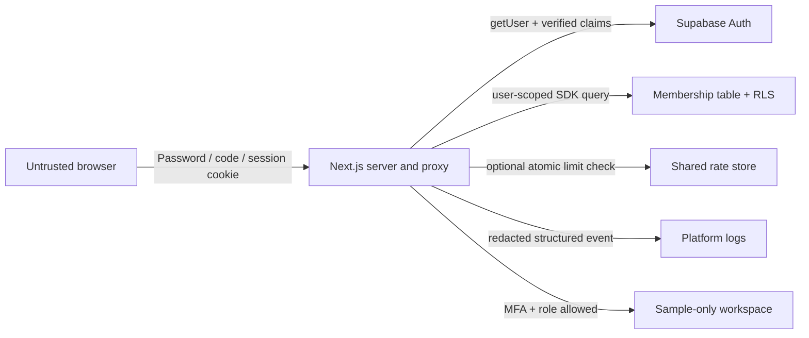

# Security applied principles and production-readiness review

Date: 2026-11-07 (Asia/Karachi). Scope: current repository, server authentication,
role authorization, deployment configuration and sample-vault UI. The user reports
that live Supabase password login works. This review did not receive live database
administrative access or test accounts and did not perform attack traffic against
production. Findings below distinguish implemented code from deployed controls.

## 1. Executive summary

**This is not yet a production secrets manager.** It is an authenticated workspace
with a sample-only vault. Secret values are fixed sample text; rotation, approvals,
leases and the dashboard audit tables are simulations. No encrypted real-secret
store or durable approval workflow exists. Implementing those is a separate backend
project, not something an audit can truthfully certify by changing labels.

Existing protections include Supabase password verification, administrator-managed
roles, own-row membership RLS, server page guards, HttpOnly/Secure/SameSite cookies,
CSRF-origin validation by Next Server Actions, generic login errors, per-request
nonce CSP, non-cacheable authentication responses, and no plaintext secret writes.

This review adds mandatory authenticator verification before workspace access,
verified token assurance/subject checks, factor-ownership checks, safe enrollment
and recovery boundaries, bounded attempt counters with optional shared Redis,
structured redacted security events, stronger browser response headers, cancellation
propagation for dependency calls, and verified-account identity in the UI. It also
patches dependencies identified by npm audit. The build and adversarial tests are
used to validate behavior; live rollout checks remain required.

**The requested statement “no unmitigated critical flaws remain” cannot be made for
real secret management.** The sample-only restriction must stay until the production
blockers in section 8 are addressed. No compliance certification is implied.

## 2. Inventory, data flows and attacker profiles

| Asset / entry point | Implementation | Trust boundary / sensitivity |
| --- | --- | --- |
| `/`, `/login/` | Root redirect, login page, `signIn` Server Action | Public; passwords submitted only to server/Supabase, never logged |
| `/mfa/` | MFA page; enroll/verify Server Actions | Password-authenticated and active member; seed returned only to enrolling owner |
| `/team-lead/`, `/developer/`, `/security-analyst/` | Each page calls `requireRole` | Verified user + active membership + verified AAL2 + matching role |
| `/provision-secret/`, `/secrets-directory/` | Both require `team_lead` | Same server controls; payloads still samples |
| Sign-out Server Action | `src/app/login/actions.ts` | Revokes current refresh session; reports failures rather than claiming success |
| Membership database | `public.workspace_members` | Own-row SELECT; no client INSERT/UPDATE/DELETE grants or policies |
| Supabase Auth | Official SDK, server-only client | Identity, password verification, JWT signing/refresh and MFA factors |
| Session cookies | Server/proxy adapters | HttpOnly; Secure in production; SameSite=Lax; never intentionally returned as action data |
| Sample records and metadata | `secretsStore.ts` and UI state | Bounded working set, no durable real-secret data; do not enter private metadata |
| Rate counters | Local bounded Map, or configured Redis REST | Account identities SHA-256 hashed in counter keys; predictable hashes are pseudonyms, not encryption |
| Security events | Server stdout JSON | Event/UUID/time/verified actor only; NOT an immutable audit service |
| Build chain / hosting | npm lockfile, GitHub Actions, Vercel | Trusted deployment code; TLS, firewall, log retention and redundancy administered externally |
| Historical ZIPs/coursework | Existing repository artifacts | Old code/security claims retained; not a deployment source or security evidence |

No runtime SQL string interpolation, custom SQL API, WebSockets, `eval`, or
`dangerouslySetInnerHTML` was found. Supabase queries use SDK filters; MFA inputs
are constrained before provider calls. Sample text rendering uses React escaping.
This does not prove the absence of every XSS or supply-chain vulnerability.

Cybercriminals and automated scanners may guess passwords, reuse stolen sessions,
or exploit framework advisories. Insiders may manipulate role/factor IDs or attempt
unauthorized reveals. Hacktivists may attack availability or deface a compromised
build. APTs may target dependencies, CI identity and operator accounts. No actual
incident history or compromise was supplied; these are threat hypotheses.

## 3. Applied principles matrix

| Principle / property | Existing controls retained | Added / verified in this review | Limitation |
| --- | --- | --- | --- |
| Confidentiality | HttpOnly/Secure cookies, no real payload persistence, role guards | AAL2 required; MFA seed only returned during owner enrollment | No AES-256 real vault or KMS exists |
| Integrity | Own-row RLS and SDK-bound query filters | Verified JWT subject must match verified user; factor ownership checked | Digital signatures/checksums are not substitutes for a future authenticated encryption design |
| Availability | Generic errors, optional clipboard fallback, bounded sample list | Rate windows; configured Redis failures deny attempts; caller abort signals preserved | No infrastructure failover or DDoS guarantee; shared limiter must be configured |
| Accountability | Supabase's provider-side auth facilities | `src/lib/security/audit.ts` and calls in login/MFA/access paths | stdout is not immutable; export and protect retention externally |
| Authentication | Supabase verifies password; no local password hashing | `src/app/mfa/*`, `MfaForm.tsx`; password alone cannot enter workspaces | First-factor compromise before initial enrollment remains a bootstrap risk |
| Least privilege | User-scoped SDK; no service key; read-only user membership | Existing verified MFA cannot be replaced through password-only enrollment | Administrative recovery must be restricted and identity-verified |
| Defense in depth | CSP, cookie flags, RLS, page guards | MFA + attempt limits + frame restrictions + Permissions Policy + HSTS | Inline styles remain allowed; edge controls still needed |
| Fail-secure defaults | Missing config/user/role and database failure deny | Invalid claims, insufficient AAL, factor mismatch and shared-limiter failures deny | Do not configure a security dependency as fail-open for uptime |
| Economy of mechanism | Standard Next and Supabase libraries | Official MFA APIs; small allowlisted event schema; atomic Redis command | No custom password hashing or encryption invented |
| Complete mediation | Every protected page revalidates server-side | MFA actions independently recheck identity, membership and factor ownership | Already-rendered sample state is not remotely erased; future data APIs need their own checks |
| Open design | Standard auth libraries and reviewed configuration | Security rests on provider-verified tokens and TOTP, not hidden routes | Browser UI is never an authorization boundary |
| Separation of privilege | Admin assigns role; user cannot edit it | Password + enrolled factor + active role required | Two-person secret approval is absent because the approval workflow is simulated |
| Least common mechanism | Per-user cookies, scoped membership query, no shared browser store | Scoped MFA factors and hashed rate keys | Global login limit is intentionally shared; sustained abuse can throttle legitimate users |

Relevant paths: `src/lib/auth/access.ts`, `src/app/login/actions.ts`,
`src/app/mfa/actions.ts`, `src/lib/security/{audit,rate-limit}.ts`,
`src/lib/supabase/{server,config}.ts`, `src/proxy.ts`, and
`supabase/migrations/202611060001_workspace_members.sql`.

## 4. STRIDE findings and remediation log

| ID | STRIDE | Concrete attacker path / finding | Resolution |
| --- | --- | --- | --- |
| F1 | Spoofing / elevation | Stolen password opens a valid member's workspace without a second factor | AAL2 enforced by every page guard; login sends AAL1 to MFA; signed claims checked against user ID |
| F2 | Tampering / elevation | Submit another user's factor ID; replace existing MFA using only password | Explicit authenticated factor ownership/type checks; verified factors block enrollment replacement; only own unverified TOTP attempts may be cleared |
| F3 | DoS / spoofing | Repeated password/code attempts through public actions | 10 login attempts/account/15 min; 100 total/min; 10 MFA attempts/user/5 min; 3 enrollments/user/15 min; optional Redis atomic windows |
| F4 | Repudiation | No structured application events for auth failures or role denial | Allowlisted structured logs for login, sign-out, MFA, rate-limit and access events; log retention remains external |
| F5 | Tampering / DoS | Vulnerable pinned Next version and transitive source-map package | Patch upgrade and repeat npm advisory scan; exploitability depends on enabled features |
| F6 | Disclosure / spoofing | Dashboard displays fictional name as signed-in identity | Pass verified account email from guarded server pages and render it as escaped text |
| F7 | Disclosure / DoS | Caller cancellation lost; unnecessary auth work on anonymous requests | Combine caller abort with per-fetch deadline; proxy avoids refresh work without auth cookies |
| F8 | Disclosure / tampering | Frame embedding and unnecessary browser capabilities | CSP frame-src none, frame-ancestors none, Permissions-Policy, HSTS in production; existing nonce CSP preserved |
| F9 | Disclosure / integrity | Users assume encryption/rotation/audit rows are real | Keep sample-only notice and fixed payloads; document production blockers; no fake security assertion |
| F10 | Elevation / configuration error | Operator accidentally supplies a legacy privileged API key through the public configuration variable | Allow publishable keys or legacy anon role only; reject service_role, malformed keys and ambiguous endpoint URLs; provider still validates key signatures |
| F11 | Disclosure / configuration error | Credential-bearing service calls follow unexpected redirects | Auth and Redis fetch reject redirects; configured service must be a canonical HTTPS origin |

Follow-up least-privilege checks are in `supabase/checks/workspace_permissions.sql`.
They inspect RLS flags, application-role bypass privileges, table/column grants and
policy definitions without modifying the project. The script is prepared but has
not been executed against the live database; it does not prove tenant isolation
for unrelated tables, views or privileged functions. User-session tests remain
required. No new policy or migration is applied automatically.

TOTP remains per-user. A shared fixed role code would be another knowledge factor,
not MFA, and would weaken revocation and attribution. The setup guide records the
provider's free TOTP API and offline code generation; no email/SMS sender is needed.

The critical Next advisory GHSA-673q-mjm6-r5xr describes `use cache` typed-array
returns; that specific code pattern was not found here. Patch anyway: dependency
severity alone is not proof that this app was exploitable. The audit also identified
Server Action DoS and source-map-js advisories. See the lockfile and final scan.

Development dependencies were also patched: zod is 4.6.7, and a narrowly scoped
override pins typescript-estree's minimatch to 11.0.1. Remove that override when
the upstream dependency range includes a patched version. Lint and build checks
validate the current combination; this does not guarantee all future combinations.

## 5. PASTA and OCTAVE

PASTA stages:
1. Objectives: protect workspace identities now; real secret custody requires a
   separate encrypted storage and approval design.
2. Scope: public Next routes/actions, Supabase Auth and membership, cookies,
   deployment pipeline, optional Redis and log destination.
3. Decomposition: browser is untrusted; server verifies identity, token assurance,
   member record and factor ownership before protected behavior.
4. Threats: credential theft, direct URL access, role/factor tampering, password
   spraying, log evasion, dependency compromise and service outage.
5. Vulnerabilities: F1–F9 above; retained unknowns include live RLS, auth policy,
   edge limits, backup quality, operator privileges and historical exposure.
6. Attack modeling: test absent/forged user, mismatched JWT subject, inactive/unknown
   role, AAL1 direct access, foreign MFA ID, failed verification, dependency errors
   and shared-counter outage. Do not test live account lockouts without a test account.
7. Impact: unauthorized real-secret access would be severe. Do not promote sample
   workflows to production use until their backend controls exist and are tested.

OCTAVE: critical assets are authentication sessions/MFA seeds, role assignments,
deployment integrity and any mistakenly entered real secret. Organizational
priorities are restricted admin recovery, provider-account MFA, rotating previously
exposed credentials, retiring old deployments, log retention and tested restoration.
Assign owners for identity recovery, infrastructure and future vault-key custody.

## 6. Dependency matrix and failure analysis

Rows are callers, columns are callees. `2` hard synchronous; `1` optional synchronous
with fallback; `1A` durable asynchronous decoupling; `0` absent. No queue is claimed.

| Caller (before) | Auth | Membership DB | Rate store | Log sink | Clipboard |
| --- | --- | --- | --- | --- | --- |
| Login | 2 | 2 | 0 | 0 | 0 |
| Protected page | 2 | 2 | 0 | 0 | 0 |
| Sample UI | 0 | 0 | 0 | 0 | 1 |

| Caller (after) | Auth | Membership DB | Rate store | Log sink | Clipboard |
| --- | --- | --- | --- | --- | --- |
| Login / MFA action | 2 | 2 | 2 when configured; otherwise local | 1 (stdout only) | 0 |
| Protected page | 2 | 2 | 0 | 1 (stdout only) | 0 |
| Sample UI | 0 | 0 | 0 | 0 | 1 |

Auth/DB/hosting are security-critical single points of failure. No `2 → 1` reduction
is justified for identity or authorization: a fallback granting access would violate
fail-secure defaults. Existing clipboard fallback stays `1`. The optional shared
limiter deliberately becomes hard when configured; partial configuration or outage
must not silently switch to weaker local counters. A future real vault must make
durable audit persistence part of the release-of-secret decision, not rely on stdout.

Hardware/browser loss discards sample state; network drops deny auth and allow retry;
software/schema errors deny membership; configuration errors disable login or rate
checks; a human can still misassign a role through admin SQL; dependency outages
require operational recovery. Redis TTL prevents permanent bucket lockout. In-process
counters cap at 5,000 entries and expire, but reset on instance restart and do not
coordinate across serverless instances. They are not a DDoS control.

## 7. FMEA and WSES

FMEA scores are estimates for prioritization, not measured probabilities. S/O/D use
1–10; larger D means harder detection. RPN=S×O×D. Post scores assume code deployed,
MFA enrolled and, for F3, shared rate limits configured. Otherwise the stated
reductions do not apply. Critical real-vault architectural gaps retain their risk.

| Failure | Before S/O/D | RPN | After S/O/D | RPN | Basis |
| --- | --- | --- | --- | --- | --- |
| Password compromise grants workspace | 9/6/7 | 378 | 9/3/4 | 108 | MFA and auth events; enrollment bootstrap still matters |
| Guessing / action abuse | 7/7/6 | 294 | 7/4/4 | 112 | Application windows + provider/edge controls; not a guarantee |
| Factor ownership/replacement mistake | 9/5/7 | 315 | 9/2/3 | 54 | Ownership, verified-factor protection, regression tests |
| Unnoticed auth/access abuse | 8/5/8 | 320 | 8/5/5 | 200 | Structured events; immutable retention missing |
| Dependency vulnerability | 9/4/7 | 252 | 9/2/3 | 54 | Patch + advisory check; new vulnerabilities remain possible |
| Wrong displayed identity | 5/7/5 | 175 | 5/2/2 | 20 | Verified account display |
| Auth/DB outage | 6/4/3 | 72 | 6/4/3 | 72 | Correct hard dependency retained |
| Treat sample vault as real | 10/6/7 | 420 | 10/6/7 | 420 | Backend still absent; no false risk reduction |

WSES = 2A + 3D + 2P + C with Low=1, Medium=3, High=5. Incident history is unknown;
P=3 is a planning assumption (±4 total uncertainty), not evidence of incidents.
Security controls do not inherently reduce accessibility or data sensitivity, so
scores are intentionally not forced downward.

| Component | Before A/D/P/C → score | After A/D/P/C → score |
| --- | --- | --- |
| Login | 5/5/3/3 → 34 | 5/5/3/3 → 34 |
| MFA flow | Not present | 3/5/3/3 → 30 |
| Membership authorization | 3/5/3/3 → 30 | 3/5/3/3 → 30 |
| Sample vault UI | 3/1/3/3 → 18 | 3/1/3/3 → 18 |
| CI / dependency supply chain | 3/5/3/5 → 32 | 3/5/3/5 → 32 |
| Security event sink | Not implemented | 3/3/3/3 → 24 |

## 8. Remaining production blockers and rollout

1. **Actual vault backend:** tenant/object ownership, authenticated encryption
   (managed KMS/envelope AES-256-GCM), key rotation/versioning, validated persistence,
   scoped reveal, expiry, revocation, transactional approvals and independent
   approvers. Do not store real values in the browser or add a superficial AES label.
2. **Immutable audit:** durable access/change records with trusted actor attribution,
   protected retention, independent monitoring and recovery. stdout and synthetic
   dashboard rows do not meet this requirement.
3. **Distributed abuse controls:** configure both Redis REST variables if using the
   included shared limiter, Supabase Auth limits and Vercel edge limits. Direct
   provider traffic can bypass this app's counters; provider protection remains
   necessary. Account-based throttling can itself be used for temporary lockouts.
4. **MFA rollout/recovery:** enable Supabase TOTP enrollment/verification, have users
   enroll after password login, verify existing factors, and document restricted
   admin recovery. No password-only removal of a verified factor is provided. Users
   with unsupported factor types must be recovered by an administrator. Live TOTP
   testing is required before rollout to all users.
5. **Infrastructure:** verify TLS versions/HTTPS at the edge, provider password policy,
   operator MFA, log retention, backups/restore and monitoring. HSTS does not prove
   TLS 1.3-only operation. Free-tier sleep/quotas are not high-availability guarantees.
6. **Session policy:** current-session refresh revocation is implemented; already
   issued access tokens may survive until expiry. Configure provider session lifetime
   and reauthentication policy. Existing rendered sample content cannot be remotely
   erased by a later role change.
7. **Historical exposure and supply chain:** audit archives/history separately,
   retire old static deployments, rotate any real credentials used previously,
   restrict deployment administrators and review dependency updates. CI action tags
   and dependency advisories alone do not establish end-to-end supply-chain trust.

No new SQL migration or service-role key is required for the MFA code. The existing
membership migration remains applicable. Shared Redis is optional for compatibility
with the already-working login, but required to claim shared application throttling.
See `SUPABASE_AUTH_SETUP.md` for exact rollout and environment configuration.

## 9. Verification

Final local results: production build on Next.js 16.4.5 passed; TypeScript, application lint and `git diff --check` passed; all 18 security regression tests passed. The full npm advisory scan (including development dependencies) reported **0 known vulnerabilities** after the dependency patches. CI also checks the full dependency tree for high/critical advisories. This is a dated advisory result, not proof of absence of flaws.

Repository-wide lint exits successfully with one existing unused-variable warning
in `.github/prompts/design-system/scripts/generate-tokens.cjs`. CommonJS files
explicitly permit `require()`; application TypeScript rules remain enabled.

HTTP smoke checks against the production server confirmed anonymous and forged-cookie denial for all five workspaces and `/mfa/`, no-store responses, per-request CSP nonce variation, Permissions Policy and HSTS. A cross-origin request using the real login Server Action identifier was rejected (HTTP 500 from the framework origin check). No live accounts were used.

Tests cover legitimate
roles as well as absent/forged identity, claim subject mismatch, AAL1 bypass,
missing/disabled membership, foreign MFA factors, invalid codes, rate exhaustion,
failed MFA upgrade, verified-factor replacement, Redis outage and log field safety.
Live Supabase database/RLS, TOTP enrollment/recovery, Redis service, provider settings,
TLS negotiation and cloud rollout have NOT been independently verified here.

Primary references: [Supabase MFA](https://supabase.com/docs/guides/auth/auth-mfa),
[provider rate limits](https://supabase.com/docs/guides/auth/rate-limits),
[Redis REST commands](https://upstash.com/docs/redis/features/restapi),
[Next critical advisory](https://github.com/advisories/GHSA-673q-mjm6-r5xr).
Installed Next documentation for proxy, Server Actions, data security and CSP was
reviewed before changing the code, including after the framework patch upgrade.
