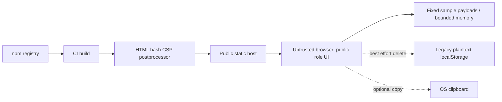

# Security Applied Principles — Vaultline

Audit date: 2026-11-06 (Asia/Karachi). Scope: working-tree application and deployment configuration. This is a source review and demo containment exercise, not a penetration test, compliance certification, or production approval.

## 1. Executive summary

The implementation is a public Next.js 16.3.7 / React static export deployed to GitHub Pages. There is no authentication server, database, vault, KMS, API, queue, or durable audit service. Previously, a hardcoded browser password selected a role; visiting a role URL bypassed it entirely. Arbitrary secret values were stored unencrypted in localStorage. Displayed AES, SHA-256, rotation, lease, and audit claims did not correspond to enforced controls.

The changes contain the public demonstration: remove credential collection, replace credential-shaped fixtures with explicit sample text, disallow editable payloads, eliminate browser persistence, attempt removal of the legacy store, bound demo record count, label simulated operations, handle clipboard denial, remove remote font dependencies, and apply CSP to exported HTML. They preserve role exploration, sample provisioning, search/filter, inspection, and simulated actions. They intentionally remove arbitrary secret entry and persistence because those features cannot safely exist in this architecture.

**Production acceptance: FAIL.** Real authentication, authorization, encryption and immutable logging remain unimplemented. It would be inaccurate to confirm that no unmitigated critical flaws remain for real secrets management. The result is a contained UI demo, not a hardened production vault.

## 2. Discovery and trust boundaries

Reviewed: all runtime files under `src/`, `next.config.ts`, package manifest/lock, TypeScript, ESLint and PostCSS configuration, `.gitignore`, deployment workflow, and the two coursework Markdown documents. Enumerated ZIP contents and scanned embedded source/JavaScript for legacy credential and persistence markers. Historical binary coursework artifacts/screenshots were not exhaustively inspected; repository history, installed dependency source, local operator credentials, and general design-prompt tooling were not comprehensively audited. No private operator configuration was printed.

| Asset / endpoint | Implementation | Trust and exposure |
| --- | --- | --- |
| `/`, `/login/` | `src/app/page.tsx`, `src/app/login/page.tsx` | Public role selector; no identity claim |
| `/team-lead/`, `/developer/`, `/security-analyst/` | Respective route pages and `RoleWorkspace.tsx` | Public samples; role comes from route, not verified identity |
| `/provision-secret/`, `/secrets-directory/` | Route pages and shared modules | Public sample provisioning and directory |
| `/_next/static/*`, exported HTML/RSC files | Next build output in `out/` | Public downloadable code and data; never a secret store |
| Demo records | `src/components/secretsStore.ts` | Fixed sample payloads in JS memory; no database |
| Browser localStorage (legacy) | `vaultline_secrets_records_v1` | Old plaintext records; deleted when permission permits, never loaded |
| Clipboard | Browser API | Optional export of sample metadata; failure handled |
| CI/build/deployment | `.github/workflows/deploy-pages.yml` | npm registry, GitHub Actions, Pages and deployment identity |
| Historical archives | `Archive.zip`, `23F-3031 _ 23F-3014.zip` | Contain old source AND built chunks with credential/persistence markers; unchanged historical evidence |

No SQL queries, API handlers, WebSocket listeners, external runtime API calls, `eval`, or `dangerouslySetInnerHTML` usage were found in the runtime source. Prepared statements and API BOLA checks therefore have no implementation point in this version. React text rendering provides normal escaping; this is not proof of immunity to all XSS.

Build infrastructure is trusted to produce code; every visitor controls their own browser. Client validation and read-only inputs are UX containment, **not server-side security boundaries**. A user can alter the local program, but there is no privileged remote resource to unlock. Metadata fields are still editable and must not contain sensitive information.

## 3. Applied security principles matrix

| Principle / property | Concrete implementation | Boundary / residual |
| --- | --- | --- |
| Confidentiality / data minimization | `secretsStore.ts`: sample `plainValue`; `loadSecrets` clones fixtures. `SecretProvisioningModule.tsx`: read-only built-in sample, fixed payload assignment. Persistence removed from `RoleWorkspace.tsx`. | No AES at rest; no real payload storage supported. JS memory is readable to the visitor. |
| Least privilege | Deployment workflow grants Pages write and OIDC token permission only to deploy job; build has contents read. | No application RBAC; public roles remain public. |
| Defense in depth | `scripts/harden-export.mjs`: inline script hashes, same-origin assets/connections, no inline event handlers/eval, no objects/frames/base URL changes/form submissions; `DemoNotice.tsx` on every route. | Same-origin scripts are trusted; inline CSS remains allowed for existing styles/motion. |
| Fail-secure behavior | Build fails if HTML cannot be hardened or no HTML exists; no legacy JSON parsing or fallback to stored user payloads. Cleanup failure is visible. | Demo operation continues with samples if storage deletion fails. Old browser data may remain. |
| Integrity | SHA-256 hashes of exact inline script bytes in export CSP; fake SHA fingerprints replaced with explicit uncomputed status. | CSP hashes are not digital signatures or record integrity guarantees. Compromised build/host can replace both policy and code. |
| Availability / graceful degradation | No runtime font service; system font fallback in `layout.tsx`. Clipboard rejection handled in both modules. Demo records capped at 100. | Static host and browser remain required. No rate limiting, DDoS guarantee, failover, or circuit breaker is claimed. |
| Economy of mechanism / open design | Standard browser APIs, Node `crypto` for CSP hashes, `crypto.randomUUID` for sample IDs; no pretend encryption routines. | UUIDs are sample identifiers, not authorization tokens. |
| Least common mechanism | No shared browser persistence, only per-mounted-workspace sample state; legacy cleanup deletes only this app's key. | Same-origin script/hosting isolation still depends on deployment. |
| Accountability / honest security UI | `DemoNotice.tsx`, login copy, module copy and README identify simulations; old coursework prefaced with correction. | No immutable or authoritative audit logs. Static event tables cannot provide non-repudiation. |
| Authentication / complete mediation / separation of privilege | Hardcoded password and password collection removed from `login/page.tsx`. | **Not implemented**: session checks, RBAC, per-object ownership, MFA, dual approval. Do not substitute client checks for these. |
| Session protection / revocation | No claimed login session or JWT is issued; returning to role picker resets mounted demo state. | No HttpOnly cookies, expiry, JWT rotation or revocation. |
| Secret hygiene | `.gitignore` excludes local AWS credentials and common private key formats. | Ignore rules do not erase history or revoke credentials. Archives remain exposed if repository is public. |

## 4. STRIDE remediation and PASTA

| ID | STRIDE | Attack / failure | Change and status |
| --- | --- | --- | --- |
| S1 | Spoofing, elevation | Shared `123456` password; direct route access; prototype-key membership in account map | Removed fake login entirely. Real authorization remains a critical production gap. |
| S2 | Information disclosure | Plaintext localStorage and credential-shaped fixture strings downloaded by anyone | Removed persistent reads/writes and replaced values with fixed sample; best-effort cleanup on every page. Previously exposed values require issuer rotation. |
| S3 | Tampering, elevation | Forged localStorage records; uncontrolled shape and size | No storage deserialization; fresh fixtures; 100-record cap, identifier validation and 100-character service bound. |
| S4 | Tampering, disclosure | No browser policy to constrain injected scripts or external sinks | Post-export script hashes and CSP constraints. No live browser exploit validation performed. |
| S5 | Repudiation | Static audit rows, fake rotation/encryption and unverified approvals | Persistent simulation notice and corrected crypto copy. Authoritative audit, approval and rotation remain missing. |
| S6 | Denial of service | Remote font build outage, browser quota/permission errors, unhandled clipboard rejection | Removed remote font imports and storage dependency; handle clipboard failure; cap records. |
| S7 | Elevation | Build job unnecessarily had deployment token privileges | Privileges moved to deploy job only. Actions still use version tags; pinning reviewed commit SHAs remains recommended. |

PASTA seven stages:
1. Business objective: demonstrate role workflows without inviting credential disclosure; production objective would require confidential, attributable access to real secrets.
2. Technical scope: public static pages, browser state, npm/CI and Pages. No backend exists.
3. Decomposition: build-to-host and host-to-browser boundaries shown above; browser-to-clipboard is optional.
4. Threat analysis: anonymous visitors download all data; XSS/extension or local users can inspect memory; malicious contributors can alter build artifacts.
5. Vulnerability analysis: S1–S7, with historical copies and unverified deployment controls retained as residual risk.
6. Attack modeling: direct role URL → inspect fixtures; submit real payload → read localStorage (removed path); alter stored JSON → render forged records (removed path); compromise dependency → alter public JavaScript (residual).
7. Business impact: credential compromise would be severe; containment reduces accidental exposure but does not qualify the app to manage credentials. Production release is blocked until backend controls are implemented and adversarially tested.

### OCTAVE and attacker profiles

Critical assets are real credentials users might mistakenly enter, CI deployment integrity, historical data, and user trust. Organizational priorities: prohibit real secret use, rotate any previously entered live credentials, review old published artifacts, assign a security owner, and define retention/incident response before production work.

Cybercriminals could harvest stored credentials; hacktivists could deface or disrupt hosting; insiders could misuse real approvals if later connected; automated scanners can discover public routes and old bundles; APTs could compromise dependencies or CI for persistence. The demo change removes one harvest path, not these adversaries. No evidence of an actual incident was supplied.

## 5. Service dependency matrix and coupling

Rows are callers; columns are callees. `2` hard synchronous, `1` soft synchronous with failure handling, `1A` asynchronous decoupled, `0` absent. Browser promises alone are not durable queues. Local in-process component calls are distinguished from network services.

| Before caller | Static host | Local sample data | localStorage | Remote fonts (build) | Clipboard | npm registry |
| --- | --- | --- | --- | --- | --- | --- |
| Build | 0 | 0 | 0 | 2 | 0 | 2 |
| Browser UI | 2 | 2 | 1 | 0 | 0 | 0 |
| Provision/directory | 0 | 2 | 1 | 0 | 2 | 0 |

| After caller | Static host | Local sample data | localStorage | Remote fonts (build) | Clipboard | npm registry |
| --- | --- | --- | --- | --- | --- | --- |
| Build | 0 | 0 | 0 | 0 | 0 | 2 |
| Browser UI | 2 | 2 | 1 (cleanup only) | 0 | 0 | 0 |
| Provision/directory | 0 | 2 | 0 | 0 | 1 | 0 |

The old store was already soft in code (exceptions caught), although persistence correctness depended on it. This is not falsely reported as a `2 → 1` conversion. Actual changes: clipboard `2 → 1`, build fonts `2 → 0`, persistence `1 → 0`. No `1A` queue was introduced. Static host, build toolchain/registry, and browser are remaining single points of failure. Replication and CDN failover are hosting work, not implemented by a React refactor. A future vault must keep authentication, authorization, key access and durable auditing hard dependencies; falling back to allow-access would be unsafe.

## 6. FMEA and WSES

These are review estimates, not measured incident probabilities or certified quantitative reductions. FMEA scales: 1–10; higher S means worse impact, O means more likely occurrence, D means harder detection. RPN = S×O×D. Post scores assume the supported sample-only demo, not hypothetical production use; severity is retained to avoid treating removal of a workflow as stronger cryptography.

| Failure mode | Before S/O/D | RPN | After S/O/D | RPN | Basis |
| --- | --- | --- | --- | --- | --- |
| Real credential persistence/exposure | 10/7/8 | 560 | 10/2/3 | 60 | Fixed payload, no writes, warning; historical data still possible |
| Mistaking public roles for authorization | 10/8/8 | 640 | 10/3/3 | 90 | No login claim, public-role notice; not RBAC |
| Forged/unbounded saved records | 6/6/6 | 216 | 6/2/2 | 24 | Never read saved JSON, bounded working list |
| Script injection impact | 8/4/7 | 224 | 8/3/5 | 120 | Export CSP; same-origin trust and no browser test remain |
| Remote font outage | 4/5/3 | 60 | 4/1/2 | 8 | Dependency removed |
| Clipboard denial | 3/5/5 | 75 | 3/5/2 | 30 | Failure visible; read/search still work |
| False audit/rotation assurance | 9/7/8 | 504 | 9/3/3 | 81 | Simulation labeled, no durable control claimed |
| Hardware/browser crash | 3/4/3 | 36 | 3/4/2 | 24 | Sample loss explicitly expected; no persistence guarantee |
| Deployment misconfiguration / old ZIP redeployment | 9/4/7 | 252 | 9/4/5 | 180 | Workflow gates and documentation; archives remain |

If real secrets are used, S1/S2/S5 retain their high pre-fix risk; demo scores do not apply. Network drops can prevent asset loading; software bugs can stop rendering; configuration/human error can skip postprocessing or redeploy old snapshots. No backup/recovery test, failover drill or load test was performed.

WSES = 2A + 3D + 2P + C; Low=1, Medium=3, High=5. Past incident history is **unknown**; P=3 is an explicit neutral planning assumption in every row, not a claim of medium incident frequency. Each total has ±4 uncertainty if actual P is 1 or 5.

| Component | Before A/D/P/C | WSES | After A/D/P/C | WSES | Interpretation |
| --- | --- | --- | --- | --- | --- |
| Login/role UI | 5/5/3/1 | 32 | 5/1/3/1 | 20 | No password collection; public accessibility unchanged |
| Provisioning/store | 5/5/3/3 | 34 | 5/1/3/3 | 22 | Only fixed sample payloads supported |
| Directory/reveal | 5/5/3/3 | 34 | 5/1/3/3 | 22 | Data sensitivity reduced, not authorization improved |
| CI/static hosting | 3/5/3/3 | 30 | 3/5/3/3 | 30 | Permissions improved; this coarse formula does not capture that |
| Historical ZIPs | 5/5/3/3 | 34 | 5/5/3/3 | 34 | Contents/history not remediated; sensitivity conservatively high |

## 7. Residual risk and production prerequisites

The requested assertion of no remaining critical flaws cannot be supported. Before handling real credentials:
- Replace static-only secret operations with a server API backed by an established identity provider/MFA, expiring HttpOnly/Secure/SameSite sessions, CSRF protection, logout revocation, and rate limits.
- Enforce fresh per-request role, tenant, ownership and lease checks for every list/reveal/create/rotate/revoke operation; default deny. Require independent approval or step-up MFA for high-value actions.
- Use managed KMS-backed AES-256-GCM envelope encryption with fresh nonces and authenticated metadata, protected keys, tested backup/restore and rotation. Use parameterized queries when a database is introduced. Do not place keys in browser bundles.
- Make access and change events durable, attributable, redacted and tamper-resistant; require audit persistence before releasing protected values. Separate security operator permissions from key-use permissions.
- Verify HTTPS/TLS settings at the actual edge, plus HSTS, `frame-ancestors`, MIME-sniffing and permissions headers. GitHub Pages static export cannot install Next response headers. A CSP meta tag cannot enforce `frame-ancestors`; clickjacking remains unmitigated here.
- Review dependencies against a reachable advisory source; pin reviewed Actions SHAs and add dependency monitoring. CI checks do not establish supply-chain trust by themselves.
- Review historical ZIPs and Git history, revoke any genuinely live values, and retire old deployments. Removing localStorage does not clear other devices, cached artifacts, clipboard history or already-exfiltrated credentials.

Reference: [MDN CSP guidance](https://developer.mozilla.org/en-US/docs/Web/HTTP/Guides/CSP) and [frame-ancestors limitations](https://developer.mozilla.org/en-US/docs/Web/HTTP/Reference/Headers/Content-Security-Policy/frame-ancestors). Next behavior was checked against installed `node_modules/next/dist/docs/01-app/02-guides/static-exports.md` and `content-security-policy.md` before implementation.

## 8. Verification status

- Security regression suite: passed. Exercises legacy storage non-read/non-write, scoped deletion, denied-storage behavior, fresh record copies, exact CSP hash bytes, policy placement, unsafe-script exclusions and malformed/repeated-export failure.
- Application/scripts/tests ESLint: passed. Repository-wide `npm run lint` has pre-existing CommonJS import errors in `.github/prompts/` tooling; those files were not rewritten.
- TypeScript (`npx tsc --noEmit`): passed. Production `npm run build`: passed with subprocess access; all routes statically exported and 10 HTML files hardened. Independently verified CSP placement before scripts and matching hashes for every inline script in all 10 files. The first sandboxed build failed because subprocess output was denied; no type checking was disabled.
- Two pre-existing compile defects repaired during validation: missing `Fingerprint` icon import in `RoleWorkspace.tsx` and the Motion easing tuple type in `login/page.tsx`.
- `git diff --check`: passed.
- Dependency advisory scan: `npm audit --omit=dev --json` failed with registry DNS `EAI_AGAIN`. No clean dependency result is claimed.
- Browser interaction, deployed HTTP headers/TLS, load/failover, backend authorization, cryptographic storage and immutable logging tests: not performed / backend controls absent.
