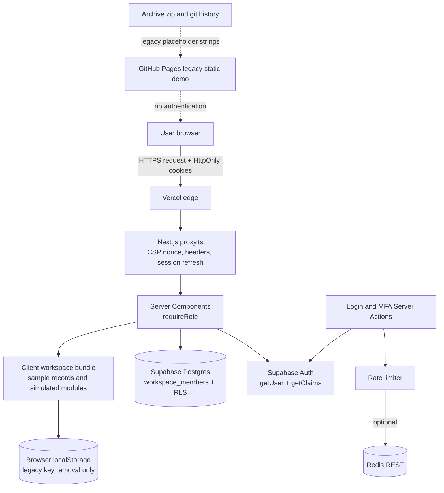

# Vaultline — System Flaws and Vulnerabilities Report

**Target:** `Centralized-Secrets-Encryption-Management-Dashboard` (Vaultline)
**Assessment type:** Evidence-based security architecture review, control assessment, and non-destructive red-team analysis
**Repository:** `https://github.com/Hafiz-Muhammad-Rizwan/Centralized-Secrets-Encryption-Management-Dashboard`
**Production URL:** `https://centralized-secrets-encryption-mana.vercel.app/`
**Legacy live URL:** `https://hafiz-muhammad-rizwan.github.io/Centralized-Secrets-Encryption-Management-Dashboard/`
**Commit assessed:** `70faff7bbebd53b31e7254ec3c3a174db5a640c0` (`Merge pull request #11 from Hafiz-Muhammad-Rizwan/TOTP`)
**Branch:** `main`
**Assessment date:** 2026-11-07
**Report status:** Final, point-in-time
**Files modified by this assessment:** none. Only this report was created.

> **Handling notice:** This report intentionally does not reproduce credential-shaped strings, tokens, seeds, passwords, cookie values, or secret payloads. Locations are identified; values are redacted.

---

## 1. Executive Numerical Summary

### 1.1 Scope and method

This assessment reviewed the current `HEAD` of the repository, the deployed Vercel application, the legacy GitHub Pages deployment, the Supabase schema/migration artifacts, CI configuration, tests, documentation, archives, and git history. The review combined:

- Static review of 3,302 lines of TypeScript/TSX under `src/`.
- Review of `package.json`, `package-lock.json`, `next.config.ts`, `vercel.json`, `.github/workflows/deploy-pages.yml`, `.gitignore`, Supabase migration/check SQL, tests, and security documentation.
- Non-destructive live HTTP checks against Vercel and GitHub Pages, including anonymous route access, redirect behavior, and response headers.
- `npm run test:security` (18/18 passed).
- `npm audit --json` (0 known vulnerabilities across 455 dependency entries at assessment time).
- Repository-wide searches for dangerous sinks, API routes, direct SQL, client-side Supabase usage, service-role keys, and credential-shaped artifacts.
- Non-destructive archive/history inspection for credential-shaped patterns; values were not used or validated against any live service.

No authenticated test accounts, Supabase administrator credentials, Vercel/Supabase logs, edge/WAF configuration, provider MFA settings, TLS scanner, backup system, or load-testing environment were available. Findings that depend on those systems are explicitly marked **unverified**.

### 1.2 Numerical dashboard

| Metric | Result |
|---|---:|
| Controls assessed | **93** |
| Status A — Implemented and secure | **32** |
| Status B — Implemented but vulnerable | **9** |
| Status C — Partially implemented | **10** |
| Status D — Missing | **24** |
| Status E — Applicable but not implemented | **9** |
| Status F — Not applicable | **3** |
| Status G — Unable to verify | **6** |
| Primary findings tracked | **13** |
| Critical findings | **2** |
| High findings | **6** |
| Medium findings | **4** |
| Low findings | **1** |
| Potential risks tracked separately | **8** |
| Unverified concerns tracked separately | **8** |
| Security regression tests | **18/18 passed** |
| Known vulnerable dependencies (`npm audit`) | **0 of 455** |
| Direct production dependencies | **35** |
| Development dependencies | **383** |
| Optional dependencies | **88** |
| Dangerous sinks found in `src/` | **0** |
| API route handlers (`route.ts`) | **0** |
| Direct SQL execution in application code | **0** |
| Client-side Supabase clients | **0** |
| Vercel protected routes correctly redirected anonymously | **6/6 sampled** |
| Legacy GitHub Pages routes served without authentication | **7/7 sampled, HTTP 200** |
| Credential-shaped placeholder categories in archives/history | **7** (redacted) |
| Real secret records observed | **0** |
| Source/config/database files modified | **0** |

### 1.3 Severity model and WSES bands

Severity is assigned by the Weighted Security Exposure Score (WSES) defined in Section 11. The bands are:

| Band | WSES | Meaning |
|---|---:|---|
| Critical | 80.0–100.0 | Blocks any real-secret production use or creates a direct high-impact exposure path |
| High | 60.0–79.9 | Serious weakness requiring prioritized remediation before wider exposure |
| Medium | 45.1–59.9 | Material defense-in-depth or governance gap; exploitability or impact is constrained |
| Low | 0.0–45.0 | Hardening or information-disclosure issue with limited practical impact |

### 1.4 Top risks

| Rank | ID | Finding | Severity | Why it matters |
|---:|---|---|---|---|
| 1 | V-07 | Obsolete unauthenticated GitHub Pages deployment plus legacy plaintext/credential-shaped artifacts | Critical | A live, unauthenticated copy of the product remains reachable; historical browser-storage code and archives create avoidable exposure and brand risk |
| 2 | V-06 | No server-side vault data plane; authorization and sample secret data live in the client | Critical | The application cannot safely hold real secrets; current UI behavior would become a serious access-control and confidentiality flaw if real data were introduced |
| 3 | V-01 | Rate limiting is per-process unless optional Redis is configured; no edge/WAF or CAPTCHA | High | Distributed password/MFA guessing and login-denial attacks are feasible; the global counter can be exhausted to disrupt legitimate users |
| 4 | V-02 | A stolen password can self-enroll the first TOTP factor for an account with no verified factor | High | MFA does not protect accounts before first enrollment; the repository documentation acknowledges this bootstrap risk |
| 5 | V-10 | Security UI and documentation make materially misleading claims about encryption, audit, FIDO2, kill switch, and coverage | High | Users and evaluators may trust controls that do not exist, increasing the chance that real secrets are entered |
| 6 | V-03 | No self-service password change/reset or verified in-app MFA recovery lifecycle | High | Credential rotation, lost-device recovery, and offboarding depend on manual, weakly evidenced administrator action |
| 7 | V-04 | Audit events go only to stdout; no durable, immutable, retained, or alerted sink; UI audit trail is synthetic | High | Abuse may be undetected and cannot be reliably investigated or proven |
| 8 | V-09 | Availability, backup, disaster recovery, and single-point-of-failure posture is unverified | High | RTO/RPO, restore capability, provider quotas, and outage behavior are unknown |
| 9 | V-05 | Sign-out is local only; no global session revocation or session inventory | Medium | Stolen sessions and access tokens can survive password change, role change, or sign-out on another device |
| 10 | V-11 | Configured Redis failure denies all login/MFA attempts | Medium | A dependency outage or misconfiguration becomes an authentication outage |
| 11 | V-08 | Supply-chain governance gaps: mutable action tags, no Dependabot/SBOM/CODEOWNERS/SECURITY.md | Medium | Build-chain compromise would be difficult to prevent, detect, or trace |
| 12 | V-12 | CSP uses `style-src 'unsafe-inline'`, has no reporting, and lacks COOP/CORP | Medium | Weaker defense-in-depth and no visibility into CSP violations |
| 13 | V-13 | HSTS lacks `includeSubDomains`/`preload`; `X-Powered-By` discloses framework | Low | Subdomain downgrade risk and unnecessary reconnaissance aid |

### 1.5 Bottom line

The deployed Vercel application has a **genuinely strong authentication boundary** for an application of this size:

- Every protected page revalidates the user on the server (`src/lib/auth/access.ts:7–39`).
- Claims are cryptographically verified, not merely decoded (`src/lib/auth/access.ts:12–14`).
- AAL2 is mandatory before any workspace is rendered (`src/lib/auth/access.ts:22, 34`).
- Roles come from a protected database row with RLS enabled and forced (`supabase/migrations/202611060001_workspace_members.sql:4–18`).
- Cookies are HttpOnly, Secure in production, and SameSite=Lax (`src/lib/supabase/config.ts:30–35`).
- No service-role key or client-side Supabase client is present.
- Anonymous access to all sampled Vercel workspace routes redirects to login.

However, the application is **not a secrets manager**. It is an authenticated, sample-only vault UI. The vault data plane, encryption, KMS, per-secret authorization, leases, approvals, rotation, durable audit, monitoring, and disaster recovery are absent or simulated. For any use involving real secrets, the correct verdict is **NO-GO until the critical and high findings are remediated**.

For the current sample-only demo, the immediate confidentiality risk on Vercel is limited because the records are fixed `DEMO_ONLY_NOT_A_CREDENTIAL` samples and no server-side secret store exists. The live legacy GitHub Pages deployment and historical artifacts still require urgent retirement and cleanup.

---

## 2. System Architecture

### 2.1 Stack and versions

| Layer | Component | Version / configuration | Evidence |
|---|---|---|---|
| Framework | Next.js | `16.4.5` (exact) | `package.json:17` |
| UI runtime | React / React DOM | `19.2.8` | `package.json:18–19` |
| Auth SDK | `@supabase/supabase-js` | `^2.119.0` | `package.json:14` |
| SSR auth | `@supabase/ssr` | `^0.12.7` | `package.json:13` |
| Icons | `lucide-react` | `^1.49.0` | `package.json:15` |
| Animation | `motion` | `^14.1.0` | `package.json:16` |
| Server guard | `server-only` | `^0.0.1` | `package.json:20` |
| Build | Node.js | `22` in CI | `.github/workflows/deploy-pages.yml:18` |
| Styling | Tailwind CSS | `^4` | `package.json:23,29` |
| Language | TypeScript | `^5` | `package.json:30` |
| Lint | ESLint | `^9`, `eslint-config-next 16.4.5` | `package.json:27–28` |
| Auth provider | Supabase Auth | External managed service | `src/lib/supabase/config.ts`, `src/lib/auth/access.ts` |
| Database | Supabase Postgres | `public.workspace_members` table + RLS | `supabase/migrations/202611060001_workspace_members.sql:4–18` |
| Hosting | Vercel | Next.js framework, `trailingSlash: true` | `vercel.json:2–4`, `next.config.ts:4–8` |
| Optional throttle store | Redis REST | Only if both env vars are set | `src/lib/security/rate-limit.ts:10–30` |
| CI | GitHub Actions | Audit, tests, lint, build | `.github/workflows/deploy-pages.yml:11–24` |
| Legacy hosting | GitHub Pages | Old static export still live | Live check, `out/`, archives |

### 2.2 Runtime components

| Component | Responsibility | Key files |
|---|---|---|
| Edge proxy / request middleware | Per-request CSP nonce, security headers, cache prevention, Supabase session refresh | `src/proxy.ts:5–46` |
| Server-side auth guard | `currentAccess`, `requireRole`, MFA/AAL check, role/membership check | `src/lib/auth/access.ts:7–39` |
| Role policy | Role allowlist, active-member check, credential bounds | `src/lib/auth/policy.ts:1–23` |
| Supabase server client | Server-only cookie-bound client, no browser Supabase client | `src/lib/supabase/server.ts:1–22` |
| Supabase config validation | URL/key validation, cookie flags, redirect/timeout-safe fetch | `src/lib/supabase/config.ts:1–46` |
| Login / logout Server Actions | Password sign-in, generic errors, throttling, local sign-out | `src/app/login/actions.ts:14–56` |
| MFA Server Actions | TOTP enrollment, factor ownership checks, challenge/verify | `src/app/mfa/actions.ts:13–60` |
| Audit logger | Allowlisted JSON security events to stdout | `src/lib/security/audit.ts:4–13` |
| Rate limiter | Optional Redis atomic fixed window, bounded in-process fallback | `src/lib/security/rate-limit.ts:4–37` |
| Role workspaces | Client-rendered sample dashboards and simulated workflows | `src/components/RoleWorkspace.tsx` |
| Provisioning module | Client-only sample record creation, no encryption/persistence | `src/components/SecretProvisioningModule.tsx` |
| Directory module | Client-only sample listing, client reveal timer, copy helpers | `src/components/SecretsDirectoryModule.tsx` |
| Sample store | Fixed demo records and one-key legacy cleanup | `src/components/secretsStore.ts` |
| Demo notice | Honest top-level sample-data notice | `src/components/DemoNotice.tsx` |

### 2.3 Trust boundaries

| Boundary | Inside | Outside | Assessment |
|---|---|---|---|
| Browser ↔ Vercel edge | Browser cookies, form posts, Server Action calls | Edge/proxy, server rendering | Cookies are HttpOnly/Secure/SameSite; Server Actions use framework origin checks; no client Supabase client |
| Vercel ↔ Supabase Auth | Server-only publishable key and user session | Supabase Auth service | TLS-only URL validation; redirects rejected; 10-second timeout; no service-role key |
| Vercel ↔ Supabase Postgres | User-scoped SDK query | `workspace_members` table | RLS enabled/forced; own-row SELECT only; no app mutation grants; live execution unverified |
| Vercel ↔ Redis REST | Optional rate-limit counters | Upstash-compatible Redis | HTTPS-only, no credentials/path/query; 3-second timeout; fail closed |
| Browser ↔ client workspace | Sample data and UI state | Client JS bundle | All role sample content and modules ship to the browser; no real secrets currently |
| Public internet ↔ GitHub Pages | Static old export | Legacy static hosting | No authentication; live; must be retired |
| Repository ↔ build chain | Source, lockfile, Actions | npm registry, GitHub Actions | Lockfile + audit + tests; Actions pinned to tags; no SBOM/CODEOWNERS |

### 2.4 Data flows



Narrative:

1. A request reaches `src/proxy.ts`. The proxy generates a nonce, sets the CSP and security headers, and refreshes the Supabase session if an `sb-` cookie exists (`src/proxy.ts:5–43`).
2. A protected page calls `requireRole(expected)` (`src/app/team-lead/page.tsx:5`, `src/app/developer/page.tsx:5`, `src/app/security-analyst/page.tsx:5`, `src/app/provision-secret/page.tsx:5`, `src/app/secrets-directory/page.tsx:5`).
3. `currentAccess` calls `getUser`, then `getClaims`, binds `claims.sub` to `user.id`, queries `workspace_members`, and requires an active allowlisted role (`src/lib/auth/access.ts:7–29`).
4. If the user is authenticated but not AAL2, `requireRole` redirects to `/mfa/` (`src/lib/auth/access.ts:34`).
5. Login and MFA actions perform throttling, call Supabase, and redirect only after server-side access checks (`src/app/login/actions.ts:14–42`, `src/app/mfa/actions.ts:13–60`).
6. The workspace UI renders sample records from `src/components/secretsStore.ts` and client state; provisioning, reveal, rotation, approvals, kill switch, and audit rows are simulations.
7. No application request sends a secret payload to a vault backend because no vault backend exists.

### 2.5 Deployment topology

| Deployment | State | Authentication | Notes |
|---|---|---|---|
| Vercel production | Live, current code | Server-side Supabase auth + mandatory AAL2 | Anonymous workspace routes redirect to `/login/?reason=access`; `/mfa/` redirects to `/login/` |
| GitHub Pages legacy | Live, old static export | None | All sampled routes return HTTP 200; page labels itself a public demo with sample data |
| Local `out/` | Present, 70 files | None | Gitignored but present on disk; old static export artifacts |
| Repository archives | `Archive.zip`, `23F-3031 _ 23F-3014.zip` | N/A | Tracked; contain old source/export and credential-shaped placeholder strings |
| Supabase project | Managed, live (assumed) | Provider-managed | Migration and check SQL present; live RLS execution not independently verified |
| Redis REST | Optional | Bearer token | Only active if both `SECURITY_REDIS_REST_URL` and `SECURITY_REDIS_REST_TOKEN` are set |

### 2.6 Asset inventory

| Asset | Confidentiality | Integrity | Availability | Current protection |
|---|---|---|---|---|
| Supabase session cookies / refresh tokens | High | High | High | HttpOnly, Secure in production, SameSite=Lax; server-side validation |
| TOTP seeds / factors | High | High | Medium | Supabase MFA; seed returned only to enrolling owner; never logged |
| Role assignments (`workspace_members`) | High | High | High | RLS forced; own-row SELECT; no app mutation grants |
| Password credentials | High | High | High | Supabase Auth; no app storage; rate-limited login |
| Sample vault records | Low | Low | Low | Fixed demo values; client memory; no real data |
| Security audit events | Medium | High | Medium | stdout JSON only; no durable sink |
| Vercel/Supabase administrator accounts | Critical | Critical | Critical | Outside repository; provider MFA unverified |
| CI/build chain | High | Critical | High | Lockfile, audit, tests, lint, build; mutable action tags |
| Legacy Pages and archives | Medium | Low | High | None; public and unauthenticated |

### 2.7 Architectural conclusion

The architecture is best described as **a server-authenticated shell around a client-side sample vault**. The authentication and role boundary is real and well implemented for a demo. The data plane that would justify the product name — server-side secret storage, encryption, KMS, per-secret authorization, leases, approvals, rotation, and durable audit — does not exist. The legacy static deployment and historical artifacts are outside the current authentication boundary and remain live.

---

## 3. Control Assessment Matrix

### 3.1 Status definitions used

| Status | Definition used in this report |
|---|---|
| **A** | Implemented and secure for the current claimed scope, with evidence and no material weakness found |
| **B** | Implemented, but the implementation has a material weakness or bypass under plausible conditions |
| **C** | Partially implemented; some elements exist, but important parts are absent, manual, or unverified |
| **D** | Missing; required for the system's stated function or for safe operation, and no implementation exists |
| **E** | Applicable to a production/real-secret posture but not implemented; outside the current sample-only scope or not yet started |
| **F** | Not applicable to this system as currently designed |
| **G** | Unable to verify with available access; evidence is insufficient |

Every control below has exactly one status.

**ID convention:** Control IDs use a group prefix (A = identity, B = authorization, C = input/browser/transport, D = secrets/data, E = supply chain, F = operations). The group prefix is **not** the status. The status letter is separate and appears in the Status column. For example, `E-06` is a supply-chain control with Status D, not a Status E control.

### 3.2 Control status counts

| Status | Count |
|---|---:|
| A | 32 |
| B | 9 |
| C | 10 |
| D | 24 |
| E | 9 |
| F | 3 |
| G | 6 |
| **Total** | **93** |

### 3.3 Matrix

#### Identity and authentication (18 controls)

| ID | Control | Status | Evidence | Assessment |
|---|---|---|---|---|
| A-01 | Password authentication delegated to Supabase Auth | A | `src/app/login/actions.ts:24–27` | No custom password storage or comparison |
| A-02 | Server-side identity verification on every protected route | A | `src/lib/auth/access.ts:8–11`; page guards | `getUser` is called per request; no trust in client identity |
| A-03 | Cryptographically verified claims and subject binding | A | `src/lib/auth/access.ts:12–14` | `getClaims` verified; `claims.sub === user.id` enforced |
| A-04 | Mandatory AAL2 before workspace access | A | `src/lib/auth/access.ts:22,34`; `src/app/mfa/page.tsx:6–10` | AAL1 sessions are redirected to MFA; page guards deny |
| A-05 | MFA factor ownership and factor-type validation | A | `src/app/mfa/actions.ts:48–52` | Factor must belong to the user and be TOTP |
| A-06 | Existing verified factor cannot be replaced by password-only action | A | `src/app/mfa/actions.ts:17,23–29` | Only unverified TOTP attempts can be cleaned up |
| A-07 | Out-of-band identity proof before first MFA enrollment | B | `src/app/mfa/actions.ts:13–34` | Stolen password can enroll the first factor; see V-02 |
| A-08 | MFA recovery with verified identity and audit | C | `src/components/MfaForm.tsx:39`; `SUPABASE_AUTH_SETUP.md:168–173` | Manual administrator recovery documented; no enforced identity proof or in-app audit |
| A-09 | Self-service password change | D | `src/app/login/actions.ts` only exposes sign-in/sign-out | Users cannot rotate a compromised password |
| A-10 | Self-service password reset | D | No reset route/action or UI | Recovery depends entirely on administrator action |
| A-11 | Account provisioning/deprovisioning lifecycle | C | `supabase/migrations/202611060001_workspace_members.sql:4–9`; `SUPABASE_AUTH_SETUP.md:35–84` | Manual SQL and `active` flag; no automated offboarding or forced revocation |
| A-12 | Global session revocation / logout-all | D | `src/app/login/actions.ts:44–56` | Sign-out uses `scope: "local"` only |
| A-13 | Session idle/absolute timeout policy | G | Provider settings not accessible | Supabase session lifetime and JWT expiry unverified |
| A-14 | Concurrent session inventory and alerting | D | No implementation | Users cannot see or revoke other sessions |
| A-15 | Per-account login rate limiting | B | `src/app/login/actions.ts:18`; `src/lib/security/rate-limit.ts:4–37` | Per-process unless Redis is configured; see V-01 |
| A-16 | Global login rate limiting | B | `src/app/login/actions.ts:19`; `src/lib/security/rate-limit.ts:4–37` | Can be exhausted to deny legitimate sign-in; per-process fallback |
| A-17 | Bot/CAPTCHA/edge abuse protection | E | No CAPTCHA or edge control in repository | Recommended in `SUPABASE_AUTH_SETUP.md:198–200` but not implemented/verified |
| A-18 | Account lockout or step-up after repeated failures | E | No lockout logic | Only counters; no progressive delay or step-up |

#### Authorization and access control (12 controls)

| ID | Control | Status | Evidence | Assessment |
|---|---|---|---|---|
| B-01 | Central server-side role guard | A | `src/lib/auth/access.ts:31–39` | Single guard used by all role pages |
| B-02 | Role allowlist and active membership enforcement | A | `src/lib/auth/policy.ts:8–14`; `src/lib/auth/access.ts:15–19` | Unknown roles and inactive members are denied |
| B-03 | Role table protected by RLS enabled and forced | A | `supabase/migrations/202611060001_workspace_members.sql:10–11` | Catalog checks also assert bypass prevention |
| B-04 | Own-row SELECT-only RLS policy | A | `supabase/migrations/202611060001_workspace_members.sql:14–16` | Users can read only their assignment |
| B-05 | No application mutation grants on role table | A | `supabase/migrations/202611060001_workspace_members.sql:12–13,17–18` | No INSERT/UPDATE/DELETE policy or grant |
| B-06 | Route-level least privilege for sensitive modules | A | `src/app/provision-secret/page.tsx:5`; `src/app/secrets-directory/page.tsx:5` | Dedicated URLs require `team_lead`; client-side module launch from Overview is a separate weakness covered by V-06 |
| B-07 | Server-side authorization for secret operations | D | No API routes or vault backend | All operations are client-side samples; see V-06 |
| B-08 | Per-secret ACL / need-to-know authorization | D | No secret table or ACL model | Any real backend would need this |
| B-09 | Two-person approval enforcement | D | `src/components/RoleWorkspace.tsx` UI only | Approval buttons show toasts |
| B-10 | Server-side lease scope and expiry enforcement | D | `src/components/RoleWorkspace.tsx:1275,1237–1245` | No lease engine; sample state only |
| B-11 | Two-person kill-switch authorization | D | `src/components/RoleWorkspace.tsx:794–826,974–977` | UI claims two-person authorization; click only shows a toast |
| B-12 | Administrative role changes under dual control | C | Manual SQL only; `SUPABASE_AUTH_SETUP.md:53–84` | No technical dual control or approval record |

#### Input, browser, and transport security (21 controls)

| ID | Control | Status | Evidence | Assessment |
|---|---|---|---|---|
| C-01 | Server Action origin/CSRF protection | A | Next.js Server Actions; framework origin checks | No custom state-changing GET endpoints |
| C-02 | Login input bounds and normalization | A | `src/lib/auth/policy.ts:16–22`; `src/components/LoginForm.tsx:68,72` | Email length/format and password length bounded |
| C-03 | MFA input validation | A | `src/app/mfa/actions.ts:41` | Factor ID UUID format and six-digit code enforced |
| C-04 | Output escaping and absence of dangerous sinks | A | Repository scan: no `dangerouslySetInnerHTML`, `eval`, `new Function`, `innerHTML`, `child_process` | React escaping used throughout |
| C-05 | Nonce-based script CSP | A | `src/proxy.ts:6–17,34` | Per-request nonce; `strict-dynamic`; no unsafe script sources |
| C-06 | CSP depth, reporting, and cross-origin isolation | C | `src/proxy.ts:10–13` | `style-src 'unsafe-inline'`; no report-to; no COOP/CORP |
| C-07 | Clickjacking protection | A | `src/proxy.ts:12,40` | `frame-ancestors 'none'` and `X-Frame-Options: DENY` |
| C-08 | MIME sniffing protection | A | `src/proxy.ts:39` | `X-Content-Type-Options: nosniff` |
| C-09 | Referrer leakage protection | A | `src/proxy.ts:38` | `Referrer-Policy: no-referrer` |
| C-10 | Sensitive response caching disabled | A | `src/proxy.ts:35–37` | `private, no-store, max-age=0`, `Pragma`, `Expires` |
| C-11 | HSTS baseline | A | `src/proxy.ts:42`; live header | `Strict-Transport-Security: max-age=31536000` |
| C-12 | HSTS `includeSubDomains` and `preload` | C | `src/proxy.ts:42` | Not present; subdomain coverage not proven |
| C-13 | Header and error information-disclosure minimization | C | Live `X-Powered-By: Next.js`; generic auth errors | Framework header still exposed; errors are generic |
| C-14 | Clipboard handling for sensitive values | C | `SecretProvisioningModule.tsx:66–76`; `SecretsDirectoryModule.tsx:111–127` | Copy works; no automatic clipboard clearing |
| C-15 | Client-side reveal auto-mask | B | `SecretsDirectoryModule.tsx:45–74` | Timer is client-only and bypassable; see V-06 |
| C-16 | Cookie flags | A | `src/lib/supabase/config.ts:30–35` | HttpOnly, Secure in production, SameSite=Lax, path `/` |
| C-17 | Cookie prefix and stronger scope hardening | C | `src/lib/supabase/config.ts:30–35` | No `__Host-` prefix; SameSite=Lax rather than Strict |
| C-18 | SSRF/open-redirect protection in auth fetch | A | `src/lib/supabase/config.ts:37–46`; `src/lib/supabase/server.ts:10–12` | HTTPS-only origin validation; redirects rejected; timeouts |
| C-19 | SQL injection exposure | F | No direct SQL; Supabase query builder | Not applicable to current code |
| C-20 | File upload security | F | No upload route or parser | Not applicable |
| C-21 | API route exposure | F | `find src/app -name route.ts` returns 0 | No API routes to protect |

#### Secrets and data protection (16 controls)

| ID | Control | Status | Evidence | Assessment |
|---|---|---|---|---|
| D-01 | Encryption at rest for secrets | D | `README.md:7–8`; sample-only code | No real secret store or encryption |
| D-02 | Managed KMS/key custody and rotation | D | No KMS integration | No envelope encryption or key hierarchy |
| D-03 | Encryption in transit | A | HTTPS-only configuration; HSTS; live TLS endpoints | Traffic is HTTPS; full TLS grade unverified (see U-05) |
| D-04 | Secret versioning and rotation engine | D | `RoleWorkspace.tsx:1237–1245,1275` | Rotation is a client state label change |
| D-05 | Secret leasing engine | D | `RoleWorkspace.tsx` sample lease pages | No server-side lease issue/expiry/revocation |
| D-06 | Durable audit trail for vault actions | D | `src/lib/security/audit.ts:4–13` | stdout only; no vault action stream |
| D-07 | Audit log integrity and immutability | D | `src/lib/security/audit.ts:6–8` comment | Repository explicitly says logs are not immutable |
| D-08 | Audit alerting and monitoring integration | D | No SIEM/alert sink | No detection pipeline |
| D-09 | Sensitive data excluded from application logs | A | `src/lib/security/audit.ts:4–13` | Allowlisted event schema; no passwords, emails, tokens, seeds, bodies |
| D-10 | Secret minimization in client bundle and state | B | `RoleWorkspace.tsx:49–101,1027–1090`; `secretsStore.ts:18–129` | All role sample data and modules ship to the browser |
| D-11 | Legacy plaintext storage cleanup | B | `secretsStore.ts:131–139`; `DemoNotice.tsx:8–12` | Removes only one app-owned key; old deployments/archives remain |
| D-12 | Obsolete deployment retirement | D | Live GitHub Pages check; `README.md:23–25` | Old static demo remains publicly reachable |
| D-13 | Credential/secret scanning of repository and artifacts | E | No gitleaks/trufflehog/SBOM scan in CI | Archives/history contain credential-shaped placeholders |
| D-14 | Backup and restore of secret data | D | No real secret data or backup configuration | Production control absent; RTO/RPO unknown |
| D-15 | Data retention and deletion policy | E | No retention/deletion implementation | Sample data resets; production policy absent |
| D-16 | Data classification and inventory | C | `README.md:7–8`; sample labels | Informal classification only; no formal inventory |

#### Supply chain and deployment (12 controls)

| ID | Control | Status | Evidence | Assessment |
|---|---|---|---|---|
| E-01 | Reproducible dependency lockfile | A | `package-lock.json`; `npm ci` in CI | Lockfile is tracked and used |
| E-02 | Known-vulnerability scanning in CI | A | `.github/workflows/deploy-pages.yml:21` | `npm audit --audit-level=high`; 0 known vulnerabilities at assessment |
| E-03 | Security regression tests in CI | A | `.github/workflows/deploy-pages.yml:22`; `tests/*.test.mjs` | 18 tests passed locally and in the workflow |
| E-04 | Lint and production build gates | A | `.github/workflows/deploy-pages.yml:23–24` | ESLint and `npm run build` |
| E-05 | GitHub Actions pinned to commit SHAs | B | `.github/workflows/deploy-pages.yml:15–16` | `actions/checkout@v4` and `actions/setup-node@v4` are mutable tags |
| E-06 | Dependency update automation | D | No Dependabot/Renovate configuration | Updates are manual |
| E-07 | SBOM and build provenance/attestation | D | None | No artifact inventory or provenance |
| E-08 | CODEOWNERS and mandatory review | D | No CODEOWNERS file | No enforced reviewer routing |
| E-09 | Vulnerability disclosure policy | D | No `SECURITY.md` | No private reporting channel |
| E-10 | Environment configuration validation and fail-closed behavior | A | `src/lib/supabase/config.ts:15–27`; `src/lib/supabase/server.ts:7–8` | Missing/unsafe config disables auth |
| E-11 | Least-privilege CI token permissions | A | `.github/workflows/deploy-pages.yml:8–9` | `contents: read` only |
| E-12 | Branch protection and signed commits | G | Remote settings not accessible | Cannot verify enforcement |

#### Operations, resilience, and governance (14 controls)

| ID | Control | Status | Evidence | Assessment |
|---|---|---|---|---|
| F-01 | Availability architecture and failover | G | No Vercel/Supabase SLA or failover evidence | Managed platform assumed; unverified |
| F-02 | DDoS/edge rate limiting | E | No WAF/edge rule configuration | Recommended in docs but not verified |
| F-03 | Application monitoring and alerting | D | No APM/alert integration | Failures may be silent |
| F-04 | Incident response plan and runbooks | E | No runbooks | No documented response process |
| F-05 | Backup and disaster-recovery testing | G | No evidence | Restore capability unknown |
| F-06 | Log retention and export | D | stdout only; `SUPABASE_AUTH_SETUP.md:202–209` | Retention/alerting explicitly external and absent |
| F-07 | Security documentation accuracy | B | `README.md:24` false claim; other overstated UI claims | See V-07 and V-10 |
| F-08 | Security ownership and training | E | No named owner/training record | Governance gap |
| F-09 | Change management and rollback | C | Git/PR/Vercel deployment; no documented rollback | Some process exists; not fully evidenced |
| F-10 | Privacy/data-handling notice | E | No privacy notice | Sample data only, but production posture absent |
| F-11 | Independent penetration test | E | None | No adversarial assurance beyond repository tests |
| F-12 | Provider administrator MFA | G | Cannot inspect Supabase/Vercel owner settings | Critical dependency; unverified |
| F-13 | TLS configuration scan | G | Only HSTS and HTTPS observed | Cipher/version grade unknown |
| F-14 | Redis outage resilience | B | `src/lib/security/rate-limit.ts:14–29` | Configured Redis failure denies authentication |

---

## 4. Master Vulnerability Matrix

### 4.1 Findings V-01 through V-13

| ID | Finding | Severity | Finding status | CWE | OWASP 2021 | Affected assets | Primary evidence | Related controls | WSES |
|---|---|---|---|---:|---|---|---|---|---:|
| V-01 | Non-distributed rate limiting, no edge/WAF/CAPTCHA, global counter exhaustion | High | Confirmed control weakness | CWE-770, CWE-307 | A04, A07 | Login, MFA, availability | `src/lib/security/rate-limit.ts:4–37`; `src/app/login/actions.ts:18–21`; `src/app/mfa/actions.ts:18,47` | A-15, A-16, A-17, A-18, F-02 | 71.5 |
| V-02 | Stolen password can self-enroll first TOTP factor | High | Confirmed conditional vulnerability | CWE-287, CWE-620 | A07 | Accounts with no verified factor | `src/app/mfa/actions.ts:13–34`; `SUPABASE_AUTH_SETUP.md:173` | A-07 | 68.5 |
| V-03 | Password change/reset and MFA recovery lifecycle gaps | High | Confirmed control gap | CWE-640, CWE-620 | A07 | All accounts | `src/app/login/actions.ts` (no reset/change); `src/components/MfaForm.tsx:39`; `SUPABASE_AUTH_SETUP.md:168–173` | A-08, A-09, A-10, A-11, A-12 | 64.0 |
| V-04 | Audit logging is stdout-only, non-durable, non-immutable, unalerted; UI trail is synthetic | High | Confirmed control gap | CWE-778, CWE-223 | A09 | Security events, investigations | `src/lib/security/audit.ts:4–13`; `src/components/RoleWorkspace.tsx:606–690,958–961` | D-06, D-07, D-08, F-03, F-06 | 63.0 |
| V-05 | Local-only sign-out; no global session revocation or inventory | Medium | Confirmed control gap | CWE-613 | A07 | Sessions, access tokens | `src/app/login/actions.ts:44–56`; `SECURITY_APPLIED_PRINCIPLES.md:242–243` | A-12, A-13, A-14 | 57.0 |
| V-06 | No server-side vault data plane; client-side authorization, plaintext state, and simulated actions | Critical | Confirmed architectural vulnerability for real-secret use | CWE-602, CWE-311, CWE-200 | A01, A02, A04 | Vault records, role data, approvals, leases | `RoleWorkspace.tsx:49–101,1027–1090,1218–1250`; `SecretProvisioningModule.tsx:37,79–145`; `SecretsDirectoryModule.tsx:45–74`; `secretsStore.ts:18–129` | B-07, B-08, B-09, B-10, B-11, D-01, D-02, D-04, D-05, D-10, C-15 | 84.0 |
| V-07 | Obsolete unauthenticated GitHub Pages deployment plus legacy plaintext/credential-shaped artifacts | Critical | Confirmed exposure/retirement gap | CWE-1188, CWE-200, CWE-312 | A02, A05 | Brand, legacy users, repository history | Live Pages 7/7 HTTP 200; `out/`; `Archive.zip`; `README.md:24`; git history `d8e966f`/`665efce`; `secretsStore.ts:131–139` | D-11, D-12, D-13, F-07 | 86.5 |
| V-08 | Supply-chain governance gaps: mutable action tags, no Dependabot/SBOM/CODEOWNERS/SECURITY.md | Medium | Confirmed governance gap; impact potential | CWE-1357, CWE-829 | A06, A08 | Build chain, dependencies, release integrity | `.github/workflows/deploy-pages.yml:15–16`; absence checks | E-05, E-06, E-07, E-08, E-09, E-12 | 55.5 |
| V-09 | Availability, backup, disaster recovery, and single-point-of-failure posture unverified | High | Confirmed absence of evidence; impact unverified | CWE-400, CWE-703 | A04, A05 | Authentication, availability, data recovery | No backup/DR configuration; `src/lib/auth/access.ts:25–28`; `src/app/login/actions.ts:36–39`; `SECURITY_APPLIED_PRINCIPLES.md:239–241,270–272` | F-01, F-03, F-05, F-12, F-13 | 61.0 |
| V-10 | Security UI/docs make misleading claims about encryption, audit, FIDO2, kill switch, and coverage | High | Confirmed misleading-assurance issue | CWE-684, CWE-223 | A04, A09 | User decisions, trust, data-handling behavior | `RoleWorkspace.tsx:545,559,566,575,625,651,799–815,1165,1359,1474`; `LoginForm.tsx:41–42`; `DemoNotice.tsx:15–17` | F-07, D-16 | 68.5 |
| V-11 | Configured Redis failure or partial configuration denies all login/MFA attempts | Medium | Confirmed resilience coupling | CWE-400, CWE-703 | A04, A05 | Authentication availability | `src/lib/security/rate-limit.ts:14–29`; `src/app/login/actions.ts:18–21`; `SUPABASE_AUTH_SETUP.md:180–198` | F-14, A-15, A-16 | 56.0 |
| V-12 | CSP uses `style-src 'unsafe-inline'`, lacks reporting and COOP/CORP | Medium | Confirmed hardening gap | CWE-693 | A05 | Browser defense-in-depth | `src/proxy.ts:10–13`; live CSP header | C-05, C-06, C-13 | 53.0 |
| V-13 | HSTS lacks `includeSubDomains`/`preload`; framework header disclosed | Low | Confirmed hardening gap | CWE-319, CWE-200 | A02, A05 | Transport, reconnaissance | `src/proxy.ts:42`; live `X-Powered-By: Next.js` | C-11, C-12, C-13 | 45.0 |

### 4.2 Potential risks register

These are plausible risks that were not confirmed as exploitable in the current deployment. They should be tracked and tested.

| ID | Potential risk | Why it is potential, not confirmed | Linked findings |
|---|---|---|---|
| P-01 | Supabase Auth provider settings permit weak passwords, unconfirmed emails, permissive redirect URLs, or long session lifetimes | Provider configuration was not accessible | V-03, V-05, A-13, E-10 |
| P-02 | Compromise of a Vercel/Supabase project administrator account | Provider owner MFA and access logs were not accessible | V-09, F-12 |
| P-03 | Historical credential-shaped values were real and reused elsewhere | Values match common example formats; no live validation was performed | V-07 |
| P-04 | Transitive dependency zero-day or maintainer compromise despite a clean audit | `npm audit` is a dated advisory check, not proof of absence | V-08 |
| P-05 | Vercel/Supabase regional outage, free-tier quota exhaustion, or provider-imposed limits | No SLA, quota, or failover evidence available | V-09, V-11 |
| P-06 | Legacy DNS/Pages takeover or stale static deployment serving modified content | Hosting ownership and DNS controls were not inspected | V-07 |
| P-07 | Endpoint compromise, malicious browser extension, or session theft on a user device | Endpoint controls are outside the application boundary | V-05, V-06 |
| P-08 | Real-secret integration without re-architecture or re-audit | Current code has no real data plane; scope creep is a governance risk | V-06, V-10 |

### 4.3 Unverified concerns register

| ID | Unverified concern | Why it could not be verified |
|---|---|---|
| U-01 | Live RLS, grants, and policy enforcement in the Supabase project | No database or administrator access |
| U-02 | Live TOTP enrollment, verification, and recovery behavior | No test accounts or authenticator devices |
| U-03 | Supabase Auth password policy, email confirmation, rate limits, redirect allowlist, session/JWT lifetime | Provider settings not accessible |
| U-04 | Vercel/Supabase log retention, metrics, alerting, and access controls | No log/metrics access |
| U-05 | Full TLS configuration and grade (versions, ciphers, certificate chain) | Only HTTPS and HSTS observed; no scanner |
| U-06 | Backup, restore, RPO/RTO, regional resilience, and provider SLA | No backup console or drill evidence |
| U-07 | Branch protection, signed commits, environment protection, and deployment approvals | Remote repository settings not accessible |
| U-08 | Whether any historical credential-shaped string was ever a live credential | Values were not used or validated; only pattern inspection was performed |

### 4.4 Confidence statement

| Area | Confidence | Reason |
|---|---|---|
| Authentication and session code | High | Direct source review and tests |
| Authorization and RLS code | High for code; low for live DB | Migration reviewed; live execution not available |
| Header and CSP behavior | High | Source plus live response headers |
| Rate limiting and outage behavior | High for code; medium for deployment | Per-process fallback and Redis path reviewed; no multi-instance load test |
| Vault functionality | High | No backend exists; modules are demonstrably client-side sample UI |
| Legacy deployment exposure | High | Live HTTP checks against all sampled routes |
| Provider configuration and operations | Low | No administrator, logs, SLA, or backup access |
| Historical credential material | Medium | Pattern inspection only; values not validated |

---

## 5. Detailed Findings

Each finding below records: status, confidence, evidence, attack path, impact, existing mitigations, remediation, and verification. No live exploitation was performed. "Attack path" describes a safe, conceptual sequence that could be tested in an authorized environment.

---

### V-01 — Non-distributed rate limiting, missing edge protection, and global-counter exhaustion

**Severity:** High (WSES 71.5)
**Status:** Confirmed control weakness
**Confidence:** High for code and deployment behavior; medium for real-world abuse volume
**Affected assets:** Login, MFA, authentication availability
**Related controls:** A-15, A-16, A-17, A-18, F-02

#### Evidence

- `src/lib/security/rate-limit.ts:4–7` states that the bounded in-process fallback is only an additional brake and is "NOT distributed protection on Vercel."
- `src/lib/security/rate-limit.ts:31–37` uses a process-local `Map` with a 5,000-bucket cap and a fixed window.
- `src/app/login/actions.ts:18–21` applies a per-account limit of 10 attempts per 15 minutes and a global application limit of 100 per minute.
- `src/app/mfa/actions.ts:18` limits enrollment to 3 attempts per 15 minutes; `src/app/mfa/actions.ts:47` limits MFA verification to 10 attempts per 5 minutes.
- `SUPABASE_AUTH_SETUP.md:175–200` explicitly says the counters are per-process without shared configuration and recommends Vercel edge/firewall limits.
- No CAPTCHA, proof-of-work, device fingerprint, IP reputation, or edge WAF rule exists in the repository.

#### Attack path

1. An attacker distributes password guesses across many Vercel serverless instances. Each instance has its own `Map`, so the per-account window is enforced only within an instance.
2. The attacker can also send enough unauthenticated login requests to exhaust the global 100-per-minute counter on an instance, causing legitimate sign-in attempts on that instance to be denied.
3. The same pattern applies to TOTP verification: 10 attempts per 5 minutes per process is materially weaker than a global account lockout or edge-enforced limit.
4. If a Redis REST endpoint is configured but unavailable, `allowAttempt` returns `false` for every attempt, turning a dependency outage into an authentication outage (see V-11).
5. The 5,000-bucket cap causes additional `false` returns under memory pressure, which is fail-closed but can be induced by a flood.

#### Impact

- Increased feasibility of password guessing, credential stuffing, and TOTP brute force.
- Temporary denial of login/MFA for legitimate users through global-counter exhaustion.
- No reliable organization-wide visibility into attempt volume.
- Current sample-only data limits the direct confidentiality impact; the availability and account-takeover risk is real for the authentication boundary.

#### Existing mitigations

- SHA-256 pseudonymization of identities before keying.
- Bounded bucket count and expiration.
- Optional atomic Redis implementation with TTL.
- Fail-closed behavior for partial/broken Redis configuration.
- Supabase provider-side auth rate limits (not independently verified).
- Generic error messages that do not reveal whether the account exists.

#### Remediation

1. Configure both Redis variables in production, or explicitly document that distributed application throttling is not claimed.
2. Add Vercel WAF/edge rate limits for `/login/`, `/mfa/`, and Server Action endpoints; use IP reputation and bot detection.
3. Add CAPTCHA or a risk-based challenge after a small number of failures.
4. Separate per-account, per-IP, and global counters so one attacker cannot exhaust a shared global bucket.
5. Consider progressive delays and temporary account lockout with safe recovery.
6. Alert on spikes, Redis errors, and global-limit saturation.
7. Document the fail-open versus fail-closed tradeoff and test both.

#### Verification

- Run a multi-instance load test in staging and confirm the intended global limit.
- Confirm a single account cannot exceed the configured limit across instances.
- Confirm a Redis outage is detected and produces the documented behavior.
- Confirm legitimate users can still sign in during a distributed flood, ideally via edge mitigation.

---

### V-02 — Stolen password can self-enroll the first TOTP factor

**Severity:** High (WSES 68.5)
**Status:** Confirmed conditional vulnerability
**Confidence:** High
**Affected assets:** Accounts with no verified MFA factor
**Related controls:** A-07

#### Evidence

- `src/app/mfa/actions.ts:13–17` allows an authenticated AAL1 user to call `enrollAuthenticator` if `access.factors.length === 0`.
- `src/app/mfa/actions.ts:30–34` creates a TOTP factor and returns the QR code and seed to the caller.
- `src/app/mfa/actions.ts:23` blocks enrollment only when a verified factor already exists.
- `SUPABASE_AUTH_SETUP.md:173` explicitly states: "stolen passwords before first enrollment remain a bootstrap risk."
- The MFA page shows the "Set up authenticator" button to any authenticated user without a factor (`src/components/MfaForm.tsx:20–26`).

#### Attack path

1. An attacker obtains a valid password through phishing, reuse, breach data, or social engineering.
2. The victim has not yet enrolled a verified TOTP factor.
3. The attacker signs in with the password. The server sees a valid AAL1 session and redirects to `/mfa/`.
4. The attacker clicks "Set up authenticator," enrolls their own TOTP device, verifies a code, and obtains an AAL2 session.
5. The attacker now has full access to the victim's workspace role. No email notification, administrator approval, or out-of-band identity proof is required.

#### Impact

- MFA does not protect accounts before first enrollment.
- Any account that has never completed TOTP setup is effectively password-only.
- The attack is especially relevant during onboarding, after account resets, or for dormant accounts.
- Current sample data limits data impact, but the authentication boundary can be taken over.

#### Existing mitigations

- A verified factor cannot be removed or replaced with a password alone (`src/app/mfa/actions.ts:17,23–29`).
- Factor ownership and type are checked before challenge (`src/app/mfa/actions.ts:48–52`).
- Enrollment is rate-limited to 3 per 15 minutes (`src/app/mfa/actions.ts:18`).
- Enrollment emits an `mfa_enrolled` audit event (`src/app/mfa/actions.ts:32`).
- Documentation acknowledges the risk.

#### Remediation

1. Require an out-of-band identity proof before first enrollment: administrator approval, a one-time enrollment link sent to the verified email, or an existing trusted device.
2. Notify the user and security owner whenever a new factor is enrolled.
3. Prefer WebAuthn/passkeys or a hardware-backed factor for privileged roles.
4. Add a grace period or risk check for accounts with unusual sign-in context.
5. Consider disabling self-enrollment for high-privilege roles and requiring an administrator to provision the factor.
6. Add an explicit "first login" state that forces enrollment under controlled conditions.

#### Verification

- In staging, create an account with no factor, sign in with only the password, and confirm enrollment requires the chosen out-of-band proof.
- Confirm a second factor cannot be added or replaced without reauthentication.
- Confirm notifications and audit events are generated.

---

### V-03 — Password change/reset and MFA recovery lifecycle gaps

**Severity:** High (WSES 64.0)
**Status:** Confirmed control gap
**Confidence:** High for code; provider capabilities unverified
**Affected assets:** All accounts, credential lifecycle, offboarding
**Related controls:** A-08, A-09, A-10, A-11, A-12

#### Evidence

- `src/app/login/actions.ts` exposes only `signIn` and `signOut`; there is no change-password or reset-password action.
- `src/lib/auth/policy.ts:16–22` only validates credential shape; it does not enforce password strength, breach screening, or rotation.
- `src/components/MfaForm.tsx:39` tells users to contact an administrator if they lose their authenticator.
- `SUPABASE_AUTH_SETUP.md:168–173` documents manual administrator recovery through Supabase administrative facilities, with identity verification outside the app.
- `SUPABASE_AUTH_SETUP.md:117–121` says sign-out revokes the current refresh session; enterprise session controls are explicitly out of scope.
- Account provisioning is manual SQL (`SUPABASE_AUTH_SETUP.md:35–84`); no offboarding script or forced revocation is defined.

#### Attack path

1. A user's password is compromised. The user cannot rotate it in the app; recovery depends on an administrator.
2. A user loses their authenticator. An administrator must verify identity outside the app and manually recover the factor. If that verification is weak, social engineering can transfer the account.
3. An employee leaves. Deactivation depends on manual SQL; existing sessions and access tokens may survive (see V-05).
4. Administrators may share initial passwords or set weak temporary passwords because there is no forced-change flow.
5. Repeated password reuse becomes more likely because self-service rotation is absent.

#### Impact

- Extended credential compromise windows.
- Weak, inconsistent recovery identity proof.
- Offboarding delays and residual access.
- Operational burden and increased social-engineering surface.
- Compliance and audit gaps around credential lifecycle.

#### Existing mitigations

- Supabase Auth may provide provider-side reset emails, but the app has no UI or documented flow.
- `active` flag and role table allow administrative deactivation.
- Generic login errors and rate limiting reduce enumeration/guessing.
- Documentation warns administrators to verify identity before recovery.

#### Remediation

1. Implement self-service password change with current-password or MFA reauthentication.
2. Implement password reset using a single-use, short-lived, verified email token; invalidate other sessions after reset.
3. Require a password change on first login and after administrative reset.
4. Implement MFA recovery with a documented, audited identity-proof process; notify the user and security owner.
5. Add an offboarding checklist and automated deactivation/revocation.
6. Enforce password strength and breached-password screening at the provider or app layer.
7. Record recovery and password-change events in the durable audit stream.

#### Verification

- Test self-service change and reset end-to-end in staging.
- Confirm old sessions are revoked after reset/change.
- Confirm MFA recovery requires the documented proof and emits audit events.
- Confirm deactivation immediately denies access on all routes.

---

### V-04 — Audit logging is stdout-only, non-durable, non-immutable, unalerted; UI trail is synthetic

**Severity:** High (WSES 63.0)
**Status:** Confirmed control gap
**Confidence:** High
**Affected assets:** Security investigations, accountability, compliance evidence
**Related controls:** D-06, D-07, D-08, F-03, F-06

#### Evidence

- `src/lib/security/audit.ts:4–13` defines an allowlisted event schema and writes JSON to `console.info`.
- The comment at `src/lib/security/audit.ts:6–8` says: "Export these logs to a protected retention sink before claiming immutability/non-repudiation."
- The event set covers login, logout, MFA, access denial, auth unavailability, and rate limiting, but not vault reads/writes because no vault exists.
- `src/components/RoleWorkspace.tsx:606–690` renders a hardcoded sample audit trail with fictional users, IPs, and events.
- `src/components/RoleWorkspace.tsx:958–961` claims "Continuous audit logging" and "Log every access event with full attribution and metadata"; the toggle is visual only.
- `SUPABASE_AUTH_SETUP.md:202–209` says logs are not immutable and must be exported, retained, and alerted externally.

#### Attack path

1. An attacker with valid credentials performs unauthorized actions (in a future real vault) or abuses authentication.
2. The only record is a stdout line in the hosting platform's ephemeral log stream.
3. If the log is not retained or is rotated, the event is lost.
4. If an administrator or platform operator has access, logs can be altered or deleted; there is no integrity proof.
5. No alert is generated, so the organization may not detect the activity until much later.
6. The UI's synthetic audit trail can create a false belief that evidence exists.

#### Impact

- Undetected account takeover, credential abuse, or future secret access.
- Inability to reconstruct incidents or satisfy audit/forensic requirements.
- Repudiation risk: actions cannot be reliably attributed.
- Misleading assurance from the synthetic UI.

#### Existing mitigations

- Allowlisted schema prevents accidental logging of passwords, tokens, seeds, emails, and request bodies.
- Events include a random UUID, timestamp, event name, and optionally a verified user ID.
- No sensitive values are written by the logger itself.

#### Remediation

1. Ship security events to a durable, access-controlled log sink or SIEM.
2. Configure retention, integrity protection (append-only/WORM or hash chaining), and legal hold as required.
3. Add alerting for repeated failures, new MFA enrollment, role changes, deactivation, and anomalous access.
4. Add event correlation IDs and source context (without logging secrets or unnecessary PII).
5. Wire the UI audit trail to real events or label every synthetic row as sample data.
6. Test log delivery, retention, search, and tamper resistance.

#### Verification

- Generate each event type and confirm it appears in the sink within the expected time.
- Confirm retention and access controls.
- Confirm alerts fire for defined thresholds.
- Attempt to alter/delete a log as a non-privileged operator and confirm failure.

---

### V-05 — Local-only sign-out; no global session revocation or inventory

**Severity:** Medium (WSES 57.0)
**Status:** Confirmed control gap
**Confidence:** High for code; provider token lifetimes unverified
**Affected assets:** Sessions, refresh tokens, access tokens, role changes
**Related controls:** A-12, A-13, A-14

#### Evidence

- `src/app/login/actions.ts:44–56` implements sign-out with `client.auth.signOut({ scope: "local" })`.
- `SECURITY_APPLIED_PRINCIPLES.md:242–243` states: "current-session refresh revocation is implemented; already issued access tokens may survive until expiry."
- There is no session list, "sign out everywhere" action, session version, or token denylist.
- Role changes and `active` deactivation do not forcibly invalidate already issued tokens; the next page load rechecks membership, but a token holder may continue until the token expires.
- Rendered client sample state is not remotely erased by a later role change (`SECURITY_APPLIED_PRINCIPLES.md:244–245`).

#### Attack path

1. An attacker steals a session cookie, refresh token, or access token from a shared device, endpoint compromise, or browser extension.
2. The legitimate user signs out. Only the local session is revoked.
3. The attacker's session remains valid until the provider's token/session expiry.
4. If the user's role is reduced or membership is deactivated, the attacker may still use an existing access token for a period.
5. The user has no way to see or revoke other sessions.

#### Impact

- Persistent unauthorized access after sign-out or credential rotation.
- Slower incident response.
- Residual access after role change or offboarding.
- Limited user visibility and control.

#### Existing mitigations

- Cookies are HttpOnly, Secure in production, and SameSite=Lax.
- Every protected page revalidates the user and membership on the next request.
- The current refresh session is revoked on local sign-out.
- Provider access-token lifetimes are typically short, but this is unverified.

#### Remediation

1. Add a "sign out all sessions" action using provider global revocation where supported.
2. Add a session inventory with device/time/last-seen information and per-session revocation.
3. Revoke sessions on password change/reset, MFA factor change, role change, and deactivation.
4. Configure short access-token/session lifetimes and reauthentication for sensitive actions.
5. Consider a server-side session version or denylist for immediate revocation.
6. Document the residual access window.

#### Verification

- Sign in from two sessions; sign out one; confirm the other is revoked or document the residual window.
- Change a role/deactivate a user; confirm existing sessions are denied within the target window.
- Confirm the session inventory shows and revokes the correct sessions.

---

### V-06 — No server-side vault data plane; client-side authorization, plaintext state, and simulated actions

**Severity:** Critical (WSES 84.0)
**Status:** Confirmed architectural vulnerability for real-secret use
**Confidence:** High
**Affected assets:** Vault records, role data, approvals, leases, rotation, audit
**Related controls:** B-07, B-08, B-09, B-10, B-11, D-01, D-02, D-04, D-05, D-10, C-15

#### Evidence

- There are no API route handlers (`find src/app -name route.ts` returns 0) and no secret table or vault service.
- `src/components/RoleWorkspace.tsx:49–101` embeds all Team Lead, Developer, and Security Analyst sample metrics, rows, and descriptions in the client bundle.
- `src/components/RoleWorkspace.tsx:1027–1090` exposes both module launch cards on the Overview for every role.
- `src/components/RoleWorkspace.tsx:1218–1250` renders `SecretProvisioningModule` and `SecretsDirectoryModule` from client state and callbacks; `onSecretAdded` and `onRotateSecret` only mutate React state.
- `src/app/provision-secret/page.tsx:5` and `src/app/secrets-directory/page.tsx:5` require `team_lead` for the dedicated URLs, but the Developer Overview can still open the same modules via `setActive`.
- `src/components/SecretProvisioningModule.tsx:37,110–145` accepts only the fixed sample payload and creates a client-side record; `handleSubmit` performs no server call.
- `src/components/SecretProvisioningModule.tsx:364` labels the button "Provision & Encrypt Secret"; the same component says the demo does not encrypt (`:401`).
- `src/components/SecretsDirectoryModule.tsx:45–74` implements a client-only 10-second reveal timer; any user can bypass it with browser tooling.
- `src/components/secretsStore.ts:18–129` contains fixed sample records with `plainValue: "DEMO_ONLY_NOT_A_CREDENTIAL"` and no persistence.
- Approval, lease, rotation, kill switch, and audit pages are static sample data or toast callbacks.

#### Attack path

- **Current sample-only state:** There is no real secret to steal. An authenticated user can open sample modules, modify client state, and see fixed demo values. This is a demo-integrity issue, not real-data exfiltration.
- **Future real-data state (the critical risk):** If real records were placed into the current client-state pattern, any authenticated user who can reach the Overview could open the modules; the browser bundle would contain role data; reveal timers and approval buttons would be client-controlled; and the server would have no per-secret authorization check.
- **Server-side bypass:** There is no server endpoint to test for IDOR today, which is precisely the gap. Adding a server endpoint later without redesigning authorization would create one.

#### Impact

- The product cannot safely store or manage real secrets.
- No per-secret need-to-know, no server-enforced lease/approval, no encryption, no rotation, no durable audit.
- Client-side controls create false assurance and are trivially bypassable.
- Role data and workflow structure are exposed to every authenticated workspace through the shared bundle.

#### Existing mitigations

- Server-side route guards protect the dedicated module URLs.
- AAL2 is mandatory.
- The sample payload is fixed and cannot be changed to an arbitrary value (`SecretProvisioningModule.tsx:110–114`).
- The top-level notice and README state that the vault is sample-only.

#### Remediation

1. Do not introduce real secrets into the current client-state architecture.
2. Design a server-side vault API with per-request authentication, per-secret ACL, and explicit authorization for every read/write/rotate/approve action.
3. Use envelope encryption with a managed KMS, key versioning, and rotation.
4. Move approvals, leases, expiry, revocation, and rotation to server-enforced workflows.
5. Keep sensitive data in server components or authenticated APIs; never ship it in the client bundle.
6. Remove module launch access from roles that should not have it, and enforce the same rule on the server.
7. Add durable audit records for every vault action.
8. Add IDOR and privilege-escalation tests with at least two real user sessions.

#### Verification

- As a developer, attempt to open the modules and call any future API; confirm server denial.
- Inspect the client bundle for secret material; confirm none.
- Confirm reveal, approval, lease, and rotation actions require server authorization and produce durable audit events.
- Test cross-tenant and cross-secret access with two accounts.

---

### V-07 — Obsolete unauthenticated GitHub Pages deployment plus legacy plaintext/credential-shaped artifacts

**Severity:** Critical (WSES 86.5)
**Status:** Confirmed exposure/retirement gap
**Confidence:** High for live exposure; medium for historical credential material
**Affected assets:** Brand, legacy users, repository history, old browser storage
**Related controls:** D-11, D-12, D-13, F-07

#### Evidence

- Live GitHub Pages routes all return HTTP 200 without authentication:
  - `/`
  - `/team-lead/`
  - `/developer/`
  - `/security-analyst/`
  - `/secrets-directory/`
  - `/provision-secret/`
  - `/login/`
- The old page states "Public demo — sample data only" and presents the old workspace UI.
- A local static export exists at `out/` (70 files), including old HTML and JS chunks. `out/` is gitignored (`.gitignore:18`) but present on disk.
- `README.md:24` claims: "There is no `out/` output or GitHub Pages deployment." This is false: `out/` exists and the Pages deployment is live.
- The repository tracks `Archive.zip` and `23F-3031 _ 23F-3014.zip`. Archive inspection found old `src/components/secretsStore.ts`, old `out/` files, and localStorage persistence code.
- Git history commits `d8e966f` and `665efce` contain the old plaintext store. Pattern inspection found seven credential-shaped placeholder categories (AWS-key-shaped, Stripe-key-shaped, webhook-secret-shaped, PostgreSQL-URI-shaped, RSA-private-key-shaped, Redis-password-shaped, Datadog-token-shaped). Values are redacted and were not validated.
- The current cleanup removes only `vaultline_secrets_records_v1` (`src/components/secretsStore.ts:131–139`); it cannot remove data from other origins, old deployments, archives, or browsers that never load the current app.
- The current workflow says "Deployment is handled by Vercel. GitHub Pages cannot run server-side auth" (`.github/workflows/deploy-pages.yml:25`), but it does not retire the old Pages site.

#### Attack path

1. An attacker or curious user visits the legacy Pages URL and accesses old workspace routes without authentication.
2. The old app is a static sample demo, so it does not expose current Vercel data. However, it normalizes an unauthenticated "vault" brand and can be used for phishing or confusion.
3. If any user entered a real secret into an older localStorage-based version, that value may remain in their browser storage on the Pages origin. The current app cannot clear another origin's storage.
4. An attacker can clone the old page or point users to it; the old page has no application authentication and is outside the current security-header boundary.
5. Archive/history strings, while apparently placeholders, create a credential-scanning and incident-response burden. If any value was ever real and reused, the exposure is external to this repository.

#### Impact

- Live unauthenticated legacy surface with no application authentication and no current application-level security controls.
- Potential historical browser-storage exposure if real values were ever entered.
- Brand/reputation risk and user confusion.
- Repository history and archives complicate secret scanning and incident response.
- The README's false statement undermines trust in the security documentation.

#### Existing mitigations

- The current app clears the known legacy localStorage key on load (`DemoNotice.tsx:8–12`, `secretsStore.ts:131–139`).
- The old page labels itself a public demo with sample data.
- `out/` is gitignored.
- The current app has no real secret data, limiting current server-side impact.

#### Remediation

1. Disable GitHub Pages for the repository immediately, or replace it with a redirect to the current Vercel login page.
2. Remove or quarantine `out/` and the old archives from the public repository; if history must be preserved, move it to a restricted archive and document the decision.
3. Run a repository-wide secret scan (including history and binary archives) and rotate any value that could ever have been live.
4. Publish a user notice explaining that the old demo is retired and that any real value entered there should be rotated.
5. Add `.gitignore` coverage and CI secret scanning to prevent recurrence.
6. Correct `README.md:23–25` and document the actual deployment/retirement state.
7. Consider a takedown/redirect request for cached or forked copies where feasible.

#### Verification

- Confirm the legacy Pages URL returns 404 or redirects to the current login.
- Confirm the repository no longer serves archives/`out/` publicly, or that access is restricted.
- Run secret scanning on current files, history, and archives; confirm no live credentials.
- Confirm the README matches reality.

---

### V-08 — Supply-chain governance gaps: mutable action tags, no Dependabot/SBOM/CODEOWNERS/SECURITY.md

**Severity:** Medium (WSES 55.5)
**Status:** Confirmed governance gap; exploitation potential
**Confidence:** High for repository state; unknown for remote branch protection
**Affected assets:** Build chain, dependencies, release integrity
**Related controls:** E-05, E-06, E-07, E-08, E-09, E-12

#### Evidence

- `.github/workflows/deploy-pages.yml:15–16` uses `actions/checkout@v4` and `actions/setup-node@v4` (mutable tags, not commit SHAs).
- The workflow does run `npm audit --audit-level=high` (`:21`), security tests (`:22`), ESLint (`:23`), and a production build (`:24`).
- CI permissions are minimal: `contents: read` (`:8–9`).
- No Dependabot/Renovate configuration, SBOM generation, provenance/attestation, CODEOWNERS, or `SECURITY.md` exists.
- `package.json:12–31` uses caret ranges for several runtime dependencies; `package-lock.json` pins the resolved tree.
- `package.json:32–36` overrides `minimatch` to `11.0.1`, which should be reviewed as part of dependency governance.
- `npm audit` reported 0 known vulnerabilities across 455 entries at assessment time, but this is a dated advisory result.

#### Attack path

1. A mutable action tag is moved to a malicious commit, or a maintainer account for a dependency is compromised.
2. The next build executes attacker-controlled code or pulls a malicious package.
3. Without CODEOWNERS/branch protection, a malicious pull request could be merged with insufficient review.
4. Without an SBOM/provenance, responders cannot quickly determine what shipped or where a component came from.
5. Without a disclosure policy, external researchers may report vulnerabilities in public issues or not at all.

#### Impact

- Build-chain compromise could lead to credential theft, auth bypass, or malicious client code.
- Slow detection and response due to missing inventory/provenance.
- Increased risk of unreviewed changes.

#### Existing mitigations

- Lockfile and `npm ci`.
- Full audit, tests, lint, and build in CI.
- Minimal CI token permissions.
- Exact Next.js version in `package.json`.

#### Remediation

1. Pin all GitHub Actions to full commit SHAs and document the update process.
2. Enable Dependabot or Renovate with a review SLA.
3. Generate an SBOM (CycloneDX/SPDX) and attach it to releases; consider build provenance/attestations.
4. Add CODEOWNERS for security-sensitive paths and enforce review.
5. Add `SECURITY.md` with a private disclosure channel.
6. Enable branch protection, signed commits/tags, and environment protection for deployments.
7. Add secret scanning and dependency review to CI.

#### Verification

- Confirm actions use SHAs.
- Confirm dependency-update PRs are generated and reviewed.
- Confirm an SBOM artifact exists for a release.
- Confirm branch protection and CODEOWNERS enforcement through the hosting API.

---

### V-09 — Availability, backup, disaster recovery, and single-point-of-failure posture unverified

**Severity:** High (WSES 61.0)
**Status:** Confirmed absence of evidence; impact unverified
**Confidence:** Low for provider operations; high for application fail-closed behavior
**Affected assets:** Authentication, availability, data recovery
**Related controls:** F-01, F-03, F-05, F-12, F-13

#### Evidence

- No backup/restore configuration, RTO/RPO target, disaster-recovery plan, or restore test evidence exists in the repository.
- Authentication depends on Vercel, Supabase Auth, Supabase Postgres, and optionally Redis; there is no application-level failover.
- `src/lib/auth/access.ts:25–28` catches errors and returns `null`, denying access.
- `src/app/login/actions.ts:36–39` catches errors and returns a generic denial.
- `src/lib/security/rate-limit.ts:14–29` fails closed when configured Redis is unavailable.
- `SECURITY_APPLIED_PRINCIPLES.md:239–241` says infrastructure, backups/restore, monitoring, and provider MFA remain to be verified.
- `SECURITY_APPLIED_PRINCIPLES.md:270–272` lists live database/RLS, Redis, provider settings, TLS, and cloud rollout as not independently verified.
- No monitoring/alerting integration or status-page dependency is present.

#### Attack path

- This is not a direct exploit. The risk is that a provider outage, quota exhaustion, misconfiguration, or data-loss event causes an authentication outage or unrecoverable loss.
- An attacker could attempt to exhaust provider quotas or trigger fail-closed behavior (e.g., Redis outage) to prolong an outage.
- Without backup/restore evidence, a database incident could destroy role assignments or future secret metadata.

#### Impact

- Unknown RTO/RPO.
- Authentication outage for all users during provider/Redis failure.
- Potential permanent loss of role or vault data in a future real deployment.
- No tested recovery path or incident communication.

#### Existing mitigations

- Managed Vercel and Supabase platforms likely provide some redundancy and backups, but this is unverified.
- The application is stateless; sample data resets on reload.
- Fail-closed behavior protects confidentiality during dependency failure.
- No service-role key reduces blast radius.

#### Remediation

1. Document RTO/RPO and the dependency/SLA inventory.
2. Enable and test Supabase backups/PITR; perform a restore drill.
3. Add provider status monitoring and application health checks.
4. Decide and document Redis fail-open versus fail-closed behavior; prefer a highly available Redis or a resilient limiter.
5. Add incident runbooks, escalation paths, and user communication templates.
6. Test regional/provider failure scenarios and quota limits.
7. For future vault data, design cross-region backup and key-recovery procedures.

#### Verification

- Restore a backup into a staging project and verify integrity.
- Simulate Supabase/Redis outage and confirm documented behavior.
- Confirm monitoring alerts and status communication.
- Review provider SLAs and quota limits.

---

### V-10 — Security UI/docs make misleading claims about encryption, audit, FIDO2, kill switch, and coverage

**Severity:** High (WSES 68.5)
**Status:** Confirmed misleading-assurance issue
**Confidence:** High
**Affected assets:** User decisions, trust, data-handling behavior
**Related controls:** F-07, D-16

#### Evidence

- Honest notices exist: `src/components/DemoNotice.tsx:15–17` and `README.md:7–8` say the vault is sample-only.
- Conflicting claims exist in the same workspace:
  - `RoleWorkspace.tsx:545,559`: "Hardware key enrolled" and "FIDO2 hardware key enrolled and active."
  - `RoleWorkspace.tsx:566,1165`: "Zero plaintext exposure."
  - `RoleWorkspace.tsx:575`: "All access events are continuously logged."
  - `RoleWorkspace.tsx:625`: "Every action is recorded, timestamped, and attributable."
  - `RoleWorkspace.tsx:651`: "100% ... All workspaces monitored."
  - `RoleWorkspace.tsx:799–815`: kill switch claims to revoke all 24 active leases and lock the workspace; the button calls `triggerToast()` (`:1295`).
  - `RoleWorkspace.tsx:932,974–977`: settings claim MFA enforcement and two-person kill-switch authorization; toggles are visual.
  - `RoleWorkspace.tsx:1359`: "All systems operational."
  - `RoleWorkspace.tsx:1474`: toast title "Action recorded."
  - `LoginForm.tsx:41–42`: "Authenticated workspace" next to "Sample data only" is mixed messaging.
- `SECURITY_APPLIED_PRINCIPLES.md:108` itself identifies the threat: users may assume encryption/rotation/audit rows are real.

#### Attack path

- No technical exploit is required. A user or evaluator reads the UI, believes the controls are real, and enters real secrets or relies on the kill switch/audit trail.
- An attacker could exploit that trust by encouraging use of the demo for real data.

#### Impact

- Users may enter real secrets into a sample-only system.
- Decision-makers may overestimate security maturity.
- Incident response may rely on a kill switch that only shows a toast.
- Audit/compliance evidence may be misrepresented.
- Reputational and potentially regulatory harm.

#### Existing mitigations

- Top-level DemoNotice on every page.
- README sample-only warning.
- Fixed sample payloads.
- Some component text explicitly says "This demo does not encrypt data" (`SecretProvisioningModule.tsx:401`).

#### Remediation

1. Remove or relabel every simulated claim; use consistent "Sample" or "Simulated" badges.
2. Replace fake metrics with either real data or explicit "demo" placeholders.
3. Disable or clearly mark non-functional toggles and buttons.
4. Make the sample-only notice prominent inside each module, not only at the top.
5. Add an interstitial before any action that could be mistaken for real provisioning.
6. Correct README and security documentation to match the implementation.
7. Add a UX/content review to the release checklist.

#### Verification

- Search the UI and docs for unsupported claims.
- Conduct a user test: can a participant correctly identify which controls are simulated?
- Confirm no action labeled "encrypt," "revoke," or "record" is non-functional without a clear warning.

---

### V-11 — Configured Redis failure or partial configuration denies all login/MFA attempts

**Severity:** Medium (WSES 56.0)
**Status:** Confirmed resilience coupling
**Confidence:** High for code; operational likelihood unverified
**Affected assets:** Authentication availability
**Related controls:** F-14, A-15, A-16

#### Evidence

- `src/lib/security/rate-limit.ts:14–16`: if either Redis variable is set, a missing counterpart returns `false`.
- `src/lib/security/rate-limit.ts:17–29`: invalid URL, non-HTTPS, credentials/path/query, non-OK response, parse failure, or timeout returns `false`.
- `src/app/login/actions.ts:18–22` denies login when either limiter returns false.
- `src/app/mfa/actions.ts:18` and `:47` deny enrollment/verification when the limiter returns false.
- `SUPABASE_AUTH_SETUP.md:180–198` documents the fail-closed behavior and says both variables must be configured and tested together.

#### Attack path

1. An operator configures Redis, then the endpoint becomes unavailable, the token expires, or the URL is mistyped.
2. Every login and MFA attempt is denied because `allowAttempt` returns false.
3. If the outage is prolonged, users cannot authenticate; the application has no fallback.
4. An attacker who can influence the Redis dependency could prolong the outage, though this is a lower-likelihood path.

#### Impact

- Self-inflicted authentication outage.
- Operational dependency on a non-critical throttle store becomes critical.
- Poor user experience and potential lockout during incidents.
- Fail-closed protects against brute force but at the cost of availability.

#### Existing mitigations

- Explicit fail-closed design avoids silently weakening throttling.
- 3-second timeout and HTTPS/redirect restrictions reduce attack surface.
- Documentation warns operators to test both variables.
- Existing signed-in page reads do not require Redis.

#### Remediation

1. Use a highly available Redis with monitoring and alerting.
2. Add a circuit breaker with a documented, monitored fail-open mode for availability-critical login, or separate throttling into independent layers.
3. Add health checks and startup validation for Redis configuration.
4. Alert on Redis errors and rate-limiter denials.
5. Document the business decision and test outage behavior.
6. Consider a local emergency fallback that still enforces a conservative limit.

#### Verification

- Simulate Redis outage in staging and confirm the documented behavior.
- Confirm alerts fire and operators can restore service.
- Verify legitimate users can authenticate during a controlled outage if fail-open is chosen.

---

### V-12 — CSP uses `style-src 'unsafe-inline'`, lacks reporting and COOP/CORP

**Severity:** Medium (WSES 53.0)
**Status:** Confirmed hardening gap
**Confidence:** High
**Affected assets:** Browser defense-in-depth, incident visibility
**Related controls:** C-05, C-06, C-13

#### Evidence

- `src/proxy.ts:9` uses a nonce and `strict-dynamic` for scripts, which is strong.
- `src/proxy.ts:10` includes `style-src 'self' 'unsafe-inline'`.
- `src/proxy.ts:11–12` sets `object-src 'none'`, `base-uri 'none'`, `form-action 'self'`, `frame-ancestors 'none'`, and `frame-src 'none'`.
- There is no `report-to`/`report-uri`, `Cross-Origin-Opener-Policy`, `Cross-Origin-Resource-Policy`, or `Cross-Origin-Embedder-Policy` header.
- The live CSP header matches the source.
- `X-Powered-By: Next.js` is present in live responses.

#### Attack path

- `unsafe-inline` for styles can enable CSS-based data exfiltration or UI redress in some scenarios, though script execution remains strongly restricted.
- Without reporting, CSP violations are invisible.
- Without COOP/CORP, cross-origin isolation is weaker.
- The framework header aids reconnaissance.

#### Impact

- Reduced defense-in-depth against style-based injection and cross-origin attacks.
- No visibility into attempted violations or misconfigurations.
- Slightly increased attack surface.

#### Existing mitigations

- Strong script CSP with per-request nonce.
- `object-src 'none'`, `base-uri 'none'`, `frame-ancestors 'none'`.
- No dangerous sinks found in `src`.
- React output escaping.

#### Remediation

1. Replace inline styles with nonce/hash-based styles or external stylesheets where feasible.
2. Add `report-to`/`report-uri` with a monitored endpoint.
3. Add `Cross-Origin-Opener-Policy: same-origin` and `Cross-Origin-Resource-Policy: same-origin`.
4. Remove `X-Powered-By` via framework configuration.
5. Test the CSP with a report-only rollout before enforcement.
6. Consider Trusted Types where compatible.

#### Verification

- Validate the CSP with an evaluator and browser console.
- Confirm reports arrive at the endpoint.
- Confirm no required functionality breaks.
- Confirm headers are present on all routes.

---

### V-13 — HSTS lacks `includeSubDomains`/`preload`; framework header disclosed

**Severity:** Low (WSES 45.0)
**Status:** Confirmed hardening gap
**Confidence:** High
**Affected assets:** Transport security, reconnaissance
**Related controls:** C-11, C-12, C-13

#### Evidence

- `src/proxy.ts:42` sets `Strict-Transport-Security: max-age=31536000` in production.
- The live header confirms the same value.
- `includeSubDomains` and `preload` are absent.
- `X-Powered-By: Next.js` is present.
- No full TLS scan was performed (U-05).

#### Attack path

- If any subdomain is served over HTTP or is compromised, it may be used for downgrade/SSL-stripping attacks or cookie injection.
- The framework header helps an attacker fingerprint the stack.
- These are low-impact on their own.

#### Impact

- Weaker transport hardening across subdomains.
- Slightly improved attacker reconnaissance.
- No direct confidentiality impact observed.

#### Existing mitigations

- One-year HSTS max-age.
- HTTPS-only Supabase URL validation.
- `upgrade-insecure-requests` in production CSP.
- Secure cookies in production.

#### Remediation

1. Inventory all subdomains and confirm HTTPS before adding `includeSubDomains`.
2. Add `includeSubDomains` and submit to the preload list once ready.
3. Remove `X-Powered-By`.
4. Run a full TLS configuration scan.
5. Monitor certificate expiry and subdomain takeover.

#### Verification

- Confirm the HSTS header includes the new directives.
- Confirm all subdomains redirect to HTTPS.
- Confirm preload status.
- Confirm the framework header is removed.

---

## 6. Missing Controls

This section expands the **Status D (24)** and **Status E (9)** controls. A D control is missing and required for the system's stated function or safe operation. An E control is applicable to a production/real-secret posture but not implemented, typically because the current scope is sample-only.

Reminder: the ID prefix is the control group, not the status. `E-06` is a supply-chain control with Status D; `A-17` is an identity control with Status E. The authoritative status for every control is in Section 3.3.

### 6.1 Status D — Missing controls (24)

| ID | Missing control | Current impact | Required for production |
|---|---|---|---|
| A-09 | Self-service password change | Users cannot rotate a compromised password | Account recovery and credential hygiene |
| A-10 | Self-service password reset | Recovery depends on manual administrator action | Safe, scalable account recovery |
| A-12 | Global session revocation | Stolen sessions can outlive sign-out | Incident response and offboarding |
| A-14 | Concurrent session inventory | Users cannot see or revoke other sessions | Session governance |
| B-07 | Server-side authorization for secret operations | All vault operations are client-side samples | Any real secret read/write |
| B-08 | Per-secret ACL / need-to-know | No way to restrict individual secrets | Least privilege for secrets |
| B-09 | Two-person approval enforcement | Approval UI only shows a toast | Sensitive access approval |
| B-10 | Server-side lease scope/expiry | No lease issuance or enforcement | Temporary access control |
| B-11 | Two-person kill-switch authorization | Kill switch only shows a toast | Emergency containment |
| D-01 | Encryption at rest for secrets | No real secret store | Confidentiality at rest |
| D-02 | Managed KMS/key custody | No key hierarchy or rotation | Cryptographic key management |
| D-04 | Secret versioning/rotation engine | Rotation is a client label change | Credential lifecycle |
| D-05 | Secret leasing engine | Lease pages are static samples | Time-bound access |
| D-06 | Durable vault audit | No vault action record exists | Accountability and forensics |
| D-07 | Audit integrity/immutability | stdout can be lost or altered | Non-repudiation |
| D-08 | Audit alerting/monitoring | No detection pipeline | Incident detection |
| D-12 | Obsolete deployment retirement | Legacy Pages remains live | Attack-surface reduction |
| D-14 | Backup/restore of secret data | No backup or restore evidence | Availability and recovery |
| E-06 | Dependency update automation | Manual update cadence | Supply-chain hygiene |
| E-07 | SBOM and provenance/attestation | No component inventory | Supply-chain traceability |
| E-08 | CODEOWNERS and mandatory review | No enforced reviewer routing | Change control |
| E-09 | Vulnerability disclosure policy | No private reporting channel | External vulnerability handling |
| F-03 | Application monitoring/alerting | Failures may be silent | Operational visibility |
| F-06 | Log retention/export | Security events are ephemeral | Investigations and compliance |

### 6.2 Status E — Applicable but not implemented (9)

| ID | Control | Why it is applicable | Current state |
|---|---|---|---|
| A-17 | Bot/CAPTCHA/edge abuse protection | Public login/MFA endpoints | No implementation; docs recommend edge limits |
| A-18 | Account lockout/step-up | Password and TOTP guessing resistance | Counters only; no progressive lockout |
| D-13 | Credential/secret scanning | Repository contains archives/history | No gitleaks/trufflehog in CI |
| D-15 | Data retention/deletion policy | Future real secret data | No policy or implementation |
| F-02 | DDoS/edge rate limiting | Public internet exposure | No WAF/edge rule evidence |
| F-04 | Incident response plan/runbooks | Security incidents are inevitable | No runbooks |
| F-08 | Security ownership/training | Operational security depends on people | No named owner/training record |
| F-10 | Privacy/data-handling notice | Future personal/secret data | No privacy notice |
| F-11 | Independent penetration test | Adversarial assurance | Repository tests only |

### 6.3 Missing-control themes

1. **Vault data plane:** B-07 through B-11 and D-01 through D-08 are the core of the missing product. They are not incremental hardening items; they require a backend design and a new threat model.
2. **Identity lifecycle:** A-09, A-10, A-12, and A-14 are normal enterprise identity controls that are absent even for the current authentication boundary.
3. **Operational assurance:** D-14, F-03, and F-06 mean the team cannot currently prove detection, recovery, or evidence preservation.
4. **Supply chain:** E-06 through E-09 are lightweight governance controls that would materially reduce build-chain risk.

---

## 7. Implemented but Vulnerable Controls (Status B)

There are **9 Status B controls**. Each works in the happy path but has a material weakness, bypass, or dependency failure mode.

### 7.1 B control summary

| ID | Control | What works | What is vulnerable | Primary finding |
|---|---|---|---|---|
| A-07 | First MFA enrollment | TOTP enrollment is implemented; verified factors cannot be replaced | A stolen password can enroll the first factor | V-02 |
| A-15 | Per-account login limit | 10 attempts per 15 minutes; hashed identity | Per-process unless Redis is configured; distributed bypass | V-01 |
| A-16 | Global login limit | 100 attempts per minute | Per-process; can be exhausted to deny legitimate users | V-01 |
| C-15 | Client reveal auto-mask | 10-second timer improves shoulder-surfing resistance | Timer is client-only and bypassable; data is already in the browser | V-06 |
| D-10 | Client bundle minimization | Current data is fixed sample text | All role data and modules ship to every authenticated browser | V-06 |
| D-11 | Legacy storage cleanup | Removes `vaultline_secrets_records_v1` and reports failure | Only one origin/key; old deployments/archives remain | V-07 |
| E-05 | Actions pinning | Workflow is readable and minimal | Uses mutable `@v4` tags rather than commit SHAs | V-08 |
| F-07 | Security documentation | README and security docs describe many controls | README falsely says there is no `out/` or Pages deployment | V-07, V-10 |
| F-14 | Redis outage resilience | Fails closed and validates URL/timeout | A configured Redis outage denies all auth | V-11 |

### 7.2 Why "implemented but vulnerable" matters

These controls can create a false sense of completeness:

- MFA exists, but the first-enrollment path is weak.
- Rate limiting exists, but it is not distributed by default.
- Reveal masking exists, but it is not a security boundary.
- Cleanup exists, but it only covers one legacy key.
- CI security gates exist, but action pinning and supply-chain governance are incomplete.
- Documentation exists, but parts of it are inaccurate.

The correct remediation is not to remove these controls; it is to make their guarantees match their claims and to add the missing layers around them.

---

## 8. STRIDE Threat Analysis

### 8.1 STRIDE summary

| Category | Threat | Asset | Scenario | Evidence | Current control | Residual risk |
|---|---|---|---|---|---|---|
| **Spoofing** | Stolen password enrolls attacker's TOTP factor | Account with no verified factor | Phish password, sign in, self-enroll, obtain AAL2 | `src/app/mfa/actions.ts:13–34` | Password + optional TOTP; verified factor cannot be replaced | High (V-02) |
| **Spoofing** | Forged cookie or claims | Session, role | Modify cookie/JWT to claim another user or role | `src/lib/auth/access.ts:8–19` | `getUser` + verified `getClaims` + subject binding + DB role lookup | Low; tests cover forged metadata |
| **Spoofing** | Stolen session token | Session | Reuse a stolen refresh/access token | `src/app/login/actions.ts:44–56` | HttpOnly/Secure/SameSite; per-request revalidation; local sign-out | Medium (V-05) |
| **Tampering** | Client-side sample/role data modification | Sample records, approvals | Use browser tooling to alter sample state, approvals, or reveal state | `RoleWorkspace.tsx:49–101,1218–1250`; `SecretsDirectoryModule.tsx:45–74` | No real data; fixed sample payloads | Critical for real-data use (V-06) |
| **Tampering** | Role table modification | `workspace_members` | Attempt to change own role or another member's row | `supabase/migrations/202611060001_workspace_members.sql:10–18` | RLS forced; no mutation grants/policies | Low for code; live unverified (U-01) |
| **Tampering** | Build/dependency tampering | Build artifacts | Move an action tag or compromise a dependency | `.github/workflows/deploy-pages.yml:15–16` | Lockfile, audit, tests, lint, build | Medium (V-08) |
| **Repudiation** | No durable attribution | Audit trail | Deny performing an action; logs are lost or altered | `src/lib/security/audit.ts:4–13` | Allowlisted stdout JSON | High (V-04) |
| **Repudiation** | Synthetic UI audit trail | User trust | Rely on hardcoded sample events as evidence | `RoleWorkspace.tsx:606–690` | Demo notice elsewhere | High (V-10) |
| **Information disclosure** | Client bundle exposes role/sample data | Sample records, role data | Inspect JS bundle or open modules from another role's Overview | `RoleWorkspace.tsx:49–101,1027–1090` | Route guards; fixed sample data | Critical for real-data use (V-06) |
| **Information disclosure** | Legacy Pages and archives | Historical data, brand | Access old unauthenticated routes; inspect archives/history | Live Pages 7/7 HTTP 200; tracked archives | None | Critical (V-07) |
| **Information disclosure** | Header/framework disclosure | Reconnaissance | Use `X-Powered-By` and CSP gaps to plan attacks | `src/proxy.ts:10,42`; live header | CSP, HSTS, nosniff, referrer policy | Low/Medium (V-12, V-13) |
| **Denial of service** | Distributed login/MFA guessing and global-counter exhaustion | Authentication availability | Spread attempts across instances; exhaust global bucket | `src/lib/security/rate-limit.ts:4–37` | Per-process counters; optional Redis | High (V-01) |
| **Denial of service** | Redis outage | Authentication availability | Configured Redis becomes unavailable | `src/lib/security/rate-limit.ts:14–29` | Fail closed | Medium (V-11) |
| **Denial of service** | Provider outage/quota | Whole application | Vercel/Supabase outage or quota exhaustion | No failover/backup evidence | Managed provider assumed | High/unverified (V-09) |
| **Elevation of privilege** | Developer opens team-lead modules | Sample vault modules | Use Overview launch cards or client state to open modules | `RoleWorkspace.tsx:1027–1090,1218–1250` | Dedicated URLs require `team_lead`; no server data plane | Critical for real-data use (V-06) |
| **Elevation of privilege** | Admin/provider compromise | Role assignments, platform | Compromise a Supabase/Vercel administrator | No provider MFA evidence | Provider controls assumed | High/unverified (P-02, F-12) |
| **Elevation of privilege** | Supply-chain code injection | Build | Inject code into the build or client bundle | Mutable action tags; no CODEOWNERS/SBOM | Audit/tests/build | Medium (V-08) |

### 8.2 STRIDE-per-element notes

| Element | Most relevant threats | Why |
|---|---|---|
| Browser/client bundle | Tampering, Information disclosure, Elevation | All sample data and workflow logic are client-side |
| `proxy.ts` | Spoofing (session refresh), Denial of service (header processing), Information disclosure | Central request boundary |
| Login/MFA Server Actions | Spoofing, Denial of service, Elevation | Authentication and throttle enforcement |
| `workspace_members` | Tampering, Elevation | Role source of truth |
| Supabase Auth | Spoofing, Denial of service | Credential and MFA provider |
| Redis REST | Denial of service | Optional but auth-critical when configured |
| GitHub Pages | Information disclosure, Spoofing | Unauthenticated legacy surface |
| Build chain | Tampering, Elevation | Code integrity |
| Audit sink (stdout) | Repudiation | No durable evidence |

### 8.3 STRIDE conclusion

The authentication boundary mitigates spoofing and unauthorized elevation well for the current demo. The dominant residual themes are:

1. **Client-side trust** for vault workflows (tampering, information disclosure, elevation).
2. **Legacy exposure** from the Pages deployment and archives (information disclosure).
3. **Availability and evidence** gaps in rate limiting, Redis dependency, audit durability, and backup/DR.
4. **Governance** gaps in supply chain and provider administration.

---

## 9. Dependency and Supply-Chain Analysis

### 9.1 Dependency inventory

`npm audit --json` at assessment time reported:

| Scope | Count |
|---|---:|
| Production dependencies | 35 |
| Development dependencies | 383 |
| Optional dependencies | 88 |
| Peer / peer optional | 0 |
| **Total dependency entries** | **455** |
| Known vulnerabilities (info/low/moderate/high/critical) | **0** |

This is a dated advisory result, not proof that no vulnerability exists. It does not cover zero-days, compromised maintainers, malicious packages, or vulnerabilities in external services.

### 9.2 Dependency matrix — direct dependencies

| Dependency | Version | Role | Failure / compromise impact | Current controls | Verification |
|---|---|---|---|---|---|
| `next` | `16.4.5` (exact) | Server rendering, proxy, Server Actions, routing | Auth bypass, RSC/data exposure, header/CSP behavior, build failure | Exact version; tests; CI build; CSP | Version verified in `package.json:17`; no known advisory at audit time |
| `react` / `react-dom` | `19.2.8` | UI runtime | XSS/rendering issues, hydration failure | React escaping; no dangerous sinks | Version verified; repository scan found no sinks |
| `@supabase/supabase-js` | `^2.119.0` | Auth and Postgres client | Session validation, MFA, claims, DB access | Server-only use; `getUser` + `getClaims`; no client client | Version range verified; lockfile pins resolved version |
| `@supabase/ssr` | `^0.12.7` | Cookie/session integration | Cookie handling/session refresh defects | HttpOnly/Secure/SameSite; server-only client | Version range verified; cookie options reviewed |
| `lucide-react` | `^1.49.0` | Icons | Low; rendering/DoS at worst | UI-only | Version verified |
| `motion` | `^14.1.0` | Client animations | Low; rendering/DoS at worst | UI-only; reduced-motion support | Version verified |
| `server-only` | `^0.0.1` | Build-time server import guard | Misuse could expose server modules to client | Used in server auth/supabase/audit/rate-limit modules | Imports reviewed |
| `@tailwindcss/postcss` | `^4` | Build-time styling | Build failure | Dev-only | Version range verified |
| `typescript` | `^5` | Type checking | Build failure | Dev-only; CI lint/build | Version range verified |
| `eslint` / `eslint-config-next` | `^9` / `16.4.5` | Linting | Build/quality gate failure | Dev-only; CI lint | Version range verified |
| `@types/node`, `@types/react`, `@types/react-dom` | `^20`, `^19`, `^19` | Type definitions | Type errors | Dev-only | Version range verified |

Notable configuration: `package.json:32–36` overrides `@typescript-eslint/typescript-estree`'s `minimatch` to `11.0.1`. Overrides should be reviewed when the parent dependency updates, because they can mask compatibility issues or become stale.

### 9.3 External service dependency matrix

| Dependency | Used for | Failure mode | Impact | Current resilience | Verification |
|---|---|---|---|---|---|
| Vercel | Hosting, edge, serverless, build | Regional outage, quota, deployment failure | Whole app unavailable; auth unavailable | Managed platform assumed; no failover evidence | Live availability only; no SLA/logs |
| Supabase Auth | Password, TOTP, sessions, claims | Outage, rate limit, misconfiguration | Login/MFA/access denied or insecure provider settings | Fail-closed app behavior; managed provider assumed | No admin access; U-02/U-03 |
| Supabase Postgres | `workspace_members` role table | Outage, RLS misconfiguration, data loss | All access denied; potential role exposure | RLS enabled/forced; own-row policy; no app mutations | Live RLS unverified (U-01) |
| Redis REST | Distributed rate limiting | Outage, token expiry, misconfiguration | All login/MFA denied if configured | Fail closed; 3-second timeout; HTTPS validation | No live Redis; V-11 |
| GitHub Actions | CI validation | Action compromise, runner outage | Bad code could merge or deploy; validation unavailable | Read-only token; audit/tests/lint/build; mutable tags | Workflow reviewed; remote protections unverified |
| npm registry | Package installation | Registry outage, malicious package, typosquat | Build failure or code compromise | Lockfile, `npm ci`, audit | No SBOM/provenance; V-08 |
| GitHub Pages | Legacy static demo | Unauthenticated stale content | Legacy exposure, brand risk | None | Live 7/7 HTTP 200; V-07 |
| DNS / TLS | Domain and certificates | Hijack, expiry, misconfiguration | Phishing, outage, downgrade | HSTS baseline; HTTPS-only config | No full TLS/DNS audit; U-05 |
| Supabase/Vercel admin accounts | Platform control | Account takeover | Full compromise of auth/data/hosting | Provider MFA assumed but unverified | U-07/F-12 |

### 9.4 Supply-chain assessment

**Strengths**

- Lockfile is tracked and CI uses `npm ci`.
- `npm audit --audit-level=high` runs in CI.
- 18 security tests, ESLint, and a production build run in CI.
- CI token permissions are minimal (`contents: read`).
- Next.js is pinned to an exact version.
- No service-role key or client-side Supabase client is present.

**Weaknesses**

- Actions are pinned to mutable tags (`@v4`), not commit SHAs.
- No Dependabot/Renovate automation.
- No SBOM or build provenance/attestation.
- No CODEOWNERS or enforced security review.
- No `SECURITY.md` disclosure policy.
- No secret scanning of current files, history, or archives.
- No dependency-review action for pull requests.
- Remote branch protection/signed-commit enforcement is unverified.
- Archives and git history contain credential-shaped placeholders, increasing scanning noise and response burden.

**Threat model**

A supply-chain attacker could target the build to inject code that exfiltrates sessions, weakens authorization, or adds a malicious client script. The current audit/tests would not necessarily detect a targeted malicious dependency or action change. Pinning SHAs, SBOM/provenance, CODEOWNERS, and secret scanning materially reduce this risk.

### 9.5 Dependency verification checklist

- [ ] All GitHub Actions pinned to full commit SHAs.
- [ ] Dependabot/Renovate enabled with review SLA.
- [ ] SBOM generated for every release.
- [ ] Build provenance/attestation available.
- [ ] CODEOWNERS enforced for `src/lib/auth`, `src/lib/supabase`, `supabase/`, `.github/`, and security docs.
- [ ] `SECURITY.md` published with a private channel.
- [ ] Secret scanning enabled for current files, history, and archives.
- [ ] Dependency review required on pull requests.
- [ ] Branch protection and signed commits/tags verified.
- [ ] Provider admin MFA verified for Vercel, Supabase, GitHub, npm, and DNS.

---

## 10. Attacker Profiles and Simulations

Six profiles were assessed. Simulations were non-destructive: no credential use, no flooding, no exploitation, and no unauthorized external attacks. "Observed" means verified through code review, live unauthenticated HTTP checks, or test evidence.

### 10.1 AP-1 — Anonymous internet scanner

| Attribute | Detail |
|---|---|
| Motivation | Opportunistic discovery, reconnaissance, automated scanning |
| Capability | Low to medium; public tools, HTTP client, crawler |
| Access | Unauthenticated internet |
| Targets | Login page, protected routes, headers, legacy Pages, exposed files |

**Simulated path**

1. Enumerate `/`, `/login/`, `/mfa/`, role routes, `/provision-secret/`, `/secrets-directory/`.
2. Inspect response codes, redirects, headers, CSP, HSTS, cookies, and framework disclosure.
3. Probe for API routes, source maps, `.env`, archives, and legacy deployments.
4. Attempt to access GitHub Pages routes without authentication.

**Observed result**

- Vercel protected routes (`/team-lead/`, `/developer/`, `/security-analyst/`, `/secrets-directory/`, `/provision-secret/`, `/mfa/`) return 307 redirects to `/login/` or `/login/?reason=access`.
- `/login/` returns 200.
- CSP nonce is per request; security headers include HSTS, XFO, nosniff, Referrer-Policy, Permissions-Policy, and no-store.
- `X-Powered-By: Next.js` is disclosed.
- Legacy GitHub Pages returns HTTP 200 for all seven sampled routes without authentication.
- No API routes or direct secret endpoints were found.
- No dangerous client sinks were found.

**Residual risk**

- Legacy Pages is the main unauthenticated surface (V-07).
- Header disclosure and CSP gaps aid reconnaissance (V-12, V-13).
- No edge/WAF evidence (V-01/F-02).

**Detection**

- Vercel/edge access logs (not reviewed).
- No application-level scanner detection or alerting.

---

### 10.2 AP-2 — Automated credential-stuffing bot

| Attribute | Detail |
|---|---|
| Motivation | Account takeover, credential validation, fraud |
| Capability | Medium to high; distributed infrastructure, proxy pools, automation |
| Access | Unauthenticated internet, large credential lists |
| Targets | `/login/`, `/mfa/`, provider auth endpoints |

**Simulated path**

1. Submit username/password pairs from breach lists across many source IPs and serverless instances.
2. Observe generic errors and timing.
3. For valid passwords, complete MFA if the attacker has a code; otherwise target accounts without verified factors.
4. Attempt to exhaust the global login counter to disrupt legitimate users.

**Observed result**

- Application throttling exists: 10 attempts/account/15 min and 100 attempts/application/min (`src/app/login/actions.ts:18–19`).
- Counters are per-process unless Redis is configured (`src/lib/security/rate-limit.ts:4–37`).
- No CAPTCHA, device reputation, or edge/WAF evidence.
- Generic errors reduce username enumeration.
- Supabase provider rate limits are assumed but unverified.
- Accounts without a verified factor are effectively password-only and can be enrolled by the attacker (V-02).

**Residual risk**

- High: distributed guessing and login denial (V-01).
- High: first-factor enrollment takeover for unenrolled accounts (V-02).

**Detection**

- `login_denied`, `rate_limited`, `mfa_denied` stdout events.
- No durable retention or alerting (V-04).
- Provider logs not reviewed.

---

### 10.3 AP-3 — Stolen-password attacker before MFA enrollment

| Attribute | Detail |
|---|---|
| Motivation | Targeted account takeover |
| Capability | Medium; phishing, breach data, social engineering, endpoint access |
| Access | Valid password; no MFA device |
| Targets | Accounts that have never completed TOTP enrollment |

**Simulated path**

1. Obtain a valid password for a target account.
2. Sign in. The server returns AAL1 and redirects to `/mfa/`.
3. If the account has no verified factor, click "Set up authenticator" and enroll the attacker's TOTP device.
4. Verify the code and obtain AAL2.
5. Access the account's role workspace.

**Observed result**

- `enrollAuthenticator` permits any authenticated AAL1 user with no factors (`src/app/mfa/actions.ts:13–17`).
- Verified factors cannot be replaced (`:23–29`), so accounts with existing MFA are protected from this path.
- Enrollment is rate-limited to 3/15 min (`:18`).
- No out-of-band approval or notification is required.
- Documentation acknowledges the bootstrap risk (`SUPABASE_AUTH_SETUP.md:173`).

**Residual risk**

- High for unenrolled accounts (V-02).
- Medium for accounts with verified factors, depending on password theft and MFA phishing.

**Detection**

- `mfa_enrolled` and `mfa_verified` events.
- No notification to the user or security owner.
- No durable alerting.

---

### 10.4 AP-4 — Authenticated low-privilege developer

| Attribute | Detail |
|---|---|
| Motivation | Curiosity, privilege escalation, data access |
| Capability | Medium; valid developer account, browser devtools |
| Access | AAL2 developer workspace |
| Targets | Team Lead modules, sample records, role data, hidden functionality |

**Simulated path**

1. Sign in as a developer and complete MFA.
2. Inspect the client bundle for role data and module code.
3. Open the Overview and click "Launch Module 1" or "Launch Module 2."
4. Attempt to navigate directly to `/provision-secret/` or `/secrets-directory/`.
5. Modify client state, reveal timers, approvals, or sample records with devtools.

**Observed result**

- Dedicated `/provision-secret/` and `/secrets-directory/` URLs require `team_lead` (`src/app/provision-secret/page.tsx:5`, `src/app/secrets-directory/page.tsx:5`).
- The Developer Overview still exposes module launch cards, and `setActive` opens the modules client-side (`RoleWorkspace.tsx:1027–1090,1218–1250`).
- All sample data and role content are in the client bundle.
- There is no server-side vault API, so there is no real data to access today.
- Client-only reveal timers and approvals are bypassable.

**Residual risk**

- Low for current sample data.
- Critical if real data is added without a server-side authorization redesign (V-06).
- Role data exposure is a design weakness even for samples.

**Detection**

- Server-side route guard would log `access_denied` only for direct URL access.
- Client-side module opening is not logged.
- No vault audit exists.

---

### 10.5 AP-5 — Malicious insider or compromised platform administrator

| Attribute | Detail |
|---|---|
| Motivation | Data theft, sabotage, persistence |
| Capability | High; database/SQL access, provider console, deployment access |
| Access | Supabase/Vercel/GitHub administrator or privileged insider |
| Targets | Role table, auth settings, deployment, logs, future secret data |

**Simulated path**

1. Use Supabase SQL access to change a role or `active` flag.
2. Use Vercel access to alter environment variables or deploy code.
3. Use provider logs to observe user activity.
4. If future vault data exists, access it directly at the provider.
5. Delete or alter audit evidence; no immutable sink exists.

**Observed result**

- Role changes are designed to be made through trusted administrative SQL (`supabase/migrations/202611060001_workspace_members.sql:17–18`).
- No dual-control or approval record exists for role changes (B-12).
- Provider MFA/access controls were not verifiable (F-12/U-07).
- No immutable audit or separation-of-duties evidence exists (V-04).
- The app has no service-role key, but a provider administrator does not need it.

**Residual risk**

- High/unverified: platform administrator compromise is outside the application's control.
- No application-level detection or non-repudiation.

**Detection**

- Provider audit logs (not reviewed).
- Application logs do not capture administrative SQL changes.

---

### 10.6 AP-6 — Supply-chain or dependency attacker

| Attribute | Detail |
|---|---|
| Motivation | Mass compromise, credential theft, persistence |
| Capability | High; maintainer compromise, malicious package, CI action manipulation |
| Access | npm/GitHub Actions/build chain |
| Targets | Build artifacts, client bundle, server auth code |

**Simulated path**

1. Compromise or typosquat a dependency, or move a mutable GitHub Action tag.
2. Wait for the next CI/build/deploy.
3. Inject code that exfiltrates sessions, weakens authorization, or adds a malicious client script.
4. Use the build's trusted context to bypass review.

**Observed result**

- Lockfile and `npm ci` reduce version drift.
- `npm audit` found 0 known vulnerabilities at assessment time.
- Actions use mutable `@v4` tags (`deploy-pages.yml:15–16`).
- No SBOM, provenance, CODEOWNERS, dependency-review, or secret scanning.
- CI token is read-only.
- Tests cover auth/security behavior but not build integrity.

**Residual risk**

- Medium: build compromise could be high impact but requires a supply-chain compromise.
- Detection is weak without SBOM/provenance and dependency review.

**Detection**

- `npm audit` only detects known advisories.
- No artifact attestation or runtime integrity monitoring.
- GitHub/npm audit logs not reviewed.

### 10.7 Attacker profile summary

| Profile | Current demo impact | Real-secret readiness impact | Primary findings |
|---|---|---|---|
| AP-1 Anonymous scanner | Medium (legacy Pages, recon) | Medium | V-07, V-12, V-13 |
| AP-2 Credential-stuffing bot | High (auth abuse/DoS) | High | V-01, V-02 |
| AP-3 Stolen-password attacker | High (account takeover) | High | V-02, V-05 |
| AP-4 Low-privilege developer | Low (sample data) | Critical | V-06 |
| AP-5 Malicious insider/admin | High/unverified | Critical | V-04, V-05, F-12 |
| AP-6 Supply-chain attacker | Medium | High | V-08 |

---

## 11. WSES and FMEA Risk Rankings

### 11.1 WSES definition

The **Weighted Security Exposure Score (WSES)** combines impact, exploitability, exposure, and control strength on a 0–100 scale:

```
WSES = 100 × ( 0.35·(I/10) + 0.30·(E/10) + 0.20·(X/10) + 0.15·((10 − C)/10) )
```

| Factor | Meaning | Scale |
|---|---|---|
| **I** | Impact if exploited | 1 = negligible, 10 = catastrophic |
| **E** | Exploitability / ease | 1 = very difficult, 10 = trivial |
| **X** | Exposure / reach | 1 = isolated, 10 = public internet / all users |
| **C** | Control strength already present | 0 = none, 10 = strong and verified |

The weights are a risk-communication device, not a substitute for judgment. Scores are based on the evidence in this report and the current sample-only scope.

### 11.2 WSES ranking

| Rank | ID | Finding | I | E | X | C | WSES | Band |
|---:|---|---|---:|---:|---:|---:|---:|---|
| 1 | V-07 | Obsolete unauthenticated Pages + legacy artifacts | 8 | 9 | 9 | 1 | **86.5** | Critical |
| 2 | V-06 | No server-side vault data plane; client-side authorization/plaintext | 9 | 7 | 9 | 1 | **84.0** | Critical |
| 3 | V-01 | Non-distributed rate limiting, no edge/WAF/CAPTCHA | 6 | 8 | 8 | 3 | **71.5** | High |
| 4 | V-02 | Stolen password can self-enroll first TOTP factor | 8 | 6 | 6 | 3 | **68.5** | High |
| 5 | V-10 | Misleading security UI/docs | 6 | 8 | 8 | 5 | **68.5** | High |
| 6 | V-03 | Password change/reset and MFA recovery gaps | 7 | 5 | 7 | 3 | **64.0** | High |
| 7 | V-04 | stdout-only, non-durable, unalerted audit | 7 | 4 | 8 | 3 | **63.0** | High |
| 8 | V-09 | Availability/backup/DR/SPOF unverified | 8 | 3 | 6 | 2 | **61.0** | High |
| 9 | V-05 | Local-only sign-out; no global revocation/inventory | 6 | 5 | 6 | 4 | **57.0** | Medium |
| 10 | V-11 | Configured Redis failure denies auth | 6 | 4 | 7 | 4 | **56.0** | Medium |
| 11 | V-08 | Supply-chain governance gaps | 7 | 4 | 5 | 4 | **55.5** | Medium |
| 12 | V-12 | CSP unsafe-inline, no reporting, no COOP/CORP | 5 | 4 | 8 | 5 | **53.0** | Medium |
| 13 | V-13 | HSTS missing flags; framework header | 4 | 3 | 8 | 6 | **45.0** | Low |

**Interpretation notes**

- V-07 ranks first because the legacy Pages deployment is live, public, and has no authentication. Its direct current confidentiality impact is limited to sample data, but the historical-storage and brand/retirement risk is severe for a secrets product.
- V-06 ranks second because it blocks real-secret use entirely. The current demo impact is limited, but the architectural gap is critical for the product's stated purpose.
- V-01 and V-02 are the highest authentication-boundary risks.
- V-10 is high because misleading assurance can cause users to enter real secrets or rely on non-existent controls.
- V-09 is high but has low confidence because provider operations were not accessible.

### 11.3 FMEA / RPN

RPN = Severity (S) × Occurrence (O) × Detection difficulty (D). Scale 1–10 each; RPN range 1–1000.

| ID | Failure mode | Effect | S | O | D | RPN | Priority |
|---|---|---|---:|---:|---:|---:|---|
| FMEA-06 | Client-only vault authorization/plaintext | Real-secret exposure if data added | 10 | 5 | 8 | **400** | Critical |
| FMEA-01 | Per-instance auth throttle | Distributed guessing, login/MFA denial | 7 | 6 | 7 | **294** | High |
| FMEA-05 | stdout-only audit | Abuse undetected; no forensic evidence | 7 | 5 | 8 | **280** | High |
| FMEA-07 | Legacy Pages remains live | Unauthenticated legacy exposure | 8 | 7 | 4 | **224** | High |
| FMEA-02 | First-factor self-enrollment | Account takeover | 9 | 4 | 6 | **216** | High |
| FMEA-13 | No backup/DR evidence | Data loss, prolonged outage | 9 | 3 | 8 | **216** | High |
| FMEA-04 | No password change/reset | Compromised password persists | 6 | 5 | 7 | **210** | High |
| FMEA-03 | No global session revocation | Stolen session persists | 7 | 4 | 7 | **196** | Medium |
| FMEA-14 | No monitoring/alerting | Delayed incident response | 7 | 4 | 7 | **196** | Medium |
| FMEA-08 | Misleading security UI | False assurance, real data entered | 6 | 6 | 5 | **180** | Medium |
| FMEA-15 | No secret scanning | Credential leakage undetected | 7 | 4 | 6 | **168** | Medium |
| FMEA-16 | No provider admin MFA evidence | Platform takeover | 10 | 2 | 8 | **160** | Medium |
| FMEA-18 | No edge/WAF limits | DDoS/availability | 6 | 5 | 5 | **150** | Medium |
| FMEA-10 | CSP unsafe-inline/no reporting | Weaker XSS defense, no visibility | 6 | 4 | 5 | **120** | Medium |
| FMEA-12 | Mutable Actions tags | Build compromise | 8 | 3 | 5 | **120** | Medium |
| FMEA-09 | Redis outage fail-closed | Auth outage | 7 | 4 | 4 | **112** | Medium |
| FMEA-17 | No CODEOWNERS/review | Malicious merge | 7 | 3 | 5 | **105** | Medium |
| FMEA-11 | HSTS missing flags | Downgrade/subdomain risk | 5 | 3 | 4 | **60** | Low |

**RPN thresholds used:** Critical ≥ 300; High 200–299; Medium 100–199; Low < 100.

### 11.4 WSES vs. FMEA reconciliation

- Both methods rank the client-only vault architecture (V-06) and legacy Pages exposure (V-07) at the top.
- FMEA ranks the missing backup/DR evidence (FMEA-13) and first-factor enrollment (FMEA-02) as high because of severity and detection difficulty.
- WSES ranks rate limiting (V-01) above V-02 because of its public exposure and ease; FMEA ranks V-02 higher because account takeover severity is greater.
- The difference is useful: WSES answers "how exposed is this now?" while FMEA answers "how badly can this fail?" The roadmap uses both.

---

## 12. Operational Reliability and Resilience

### 12.1 Failure-domain matrix

| Failure domain | Scenario | Expected application behavior | Evidence | Resilience rating | Gap / action |
|---|---|---|---|---|---|
| Supabase Auth outage | `getUser`/`getClaims` fails or times out | Access denied; login returns generic error | `src/lib/auth/access.ts:25–28`; `src/app/login/actions.ts:36–39`; `config.ts:37–46` | Fail-closed, availability poor | Add provider status monitoring, retries only where safe, incident runbook |
| Supabase Postgres outage | `workspace_members` query errors | Access denied; `auth_unavailable` audit | `src/lib/auth/access.ts:15–17` | Fail-closed | Backup/restore, read replica if required, health checks |
| Redis outage | Configured Redis is down | All login/MFA denied | `src/lib/security/rate-limit.ts:14–29` | Fail-closed, high blast radius | HA Redis, circuit breaker, documented fail-open option (V-11) |
| Redis partial config | One variable missing | All login/MFA denied | `rate-limit.ts:14–16` | Fail-closed | Startup validation, deploy-time check |
| Vercel instance scaling | In-memory counters reset/spread | Per-instance limits only | `rate-limit.ts:4–7,31–37` | Weak | Configure Redis + edge limits (V-01) |
| Vercel outage/quota | Platform unavailable | Whole app unavailable | No failover evidence | Unknown | SLA/status monitoring, quota alerts, DR plan (V-09) |
| DDoS/flood | High request volume | Edge/provider behavior unknown; global counter can be exhausted | No WAF/edge evidence | Unknown | Edge/WAF, CAPTCHA, per-IP limits (V-01/F-02) |
| Log pipeline | stdout lost/rotated | No security evidence | `audit.ts:4–13` | Weak | Durable sink, retention, alerting (V-04) |
| Backup/restore | Data corruption/loss | No documented recovery | No evidence | Unknown | Enable/test backups, RTO/RPO (V-09) |
| TLS/DNS | Certificate expiry, subdomain takeover | Downgrade/outage/phishing | HSTS only; no scan | Partially mitigated | Full TLS/DNS audit, includeSubDomains/preload (V-13) |
| Deployment rollback | Bad release | Vercel rollback likely | Not documented | Partial | Document and test rollback |
| Key rotation | Supabase key/environment change | Redeploy required | No runbook | Partial | Document rotation and emergency revocation |
| Legacy Pages | Old static site remains | Independent unauthenticated surface | Live 7/7 HTTP 200 | None | Retire/redirect (V-07) |

### 12.2 Availability and recovery assessment

| Question | Answer |
|---|---|
| Is the application stateless? | Yes; sample data resets on reload; no application-level session store |
| Can it authenticate if Supabase is down? | No; it fails closed |
| Can it authenticate if Redis is configured and down? | No; it fails closed |
| Is there a tested backup/restore? | Unverified; no evidence |
| Is there multi-region failover? | Unverified |
| Is there a documented RTO/RPO? | No evidence |
| Is there a status page or user communication plan? | No evidence |
| Is there capacity headroom for a login flood? | Unknown; global limit 100/min per process |
| Is there a single point of failure? | Vercel, Supabase Auth, Supabase Postgres, and optionally Redis are all critical dependencies |

### 12.3 Monitoring and detection

**Current state**

- Application security events are JSON lines on stdout (`audit.ts:4–13`).
- No APM, error tracker, SIEM, alert route, or dashboard is integrated.
- No health check or synthetic login probe exists.
- Provider logs/metrics were not accessible for this review.

**Minimum production monitoring**

1. Login success/failure rate by account and source.
2. MFA enrollment/verification failures and new-factor events.
3. Rate-limit denials and Redis errors.
4. Access-denied and `auth_unavailable` events.
5. Provider status and quota usage.
6. Error rate, latency, and saturation.
7. Certificate expiry and DNS changes.
8. Backup success/failure.

### 12.4 Incident response readiness

| Capability | Status | Gap |
|---|---|---|
| Documented IR plan | Missing | No runbooks or severity definitions |
| Contact/escalation tree | Missing | No on-call or owner |
| Session revocation | Local only | No global/logout-all (V-05) |
| Account deactivation | Manual SQL | No tested offboarding |
| Evidence preservation | stdout only | No durable/immutable audit (V-04) |
| Kill switch | Simulated UI | No real containment control (V-06/V-10) |
| Backup/restore | Unverified | No drill (V-09) |
| User communication | Missing | No templates/status page |
| Post-incident review | Missing | No process |

### 12.5 Reliability recommendations

1. **P0:** Retire legacy Pages; configure distributed rate limiting and edge protection; document Redis outage behavior.
2. **P0:** Add provider status monitoring and a synthetic login/MFA probe.
3. **P1:** Enable and test Supabase backups/PITR; document RTO/RPO.
4. **P1:** Ship security events to a durable sink with retention and alerts.
5. **P1:** Write incident runbooks for account takeover, credential leak, provider outage, and legacy exposure.
6. **P2:** Test regional/provider failures and quota exhaustion.
7. **P2:** Add a status page and user communication templates.
8. **P3:** Conduct tabletop exercises and restore drills at least annually.

---

## 13. Prioritized Remediation Roadmap

### 13.1 Priority definitions

| Priority | Timeframe | Meaning |
|---|---|---|
| **P0** | 0–7 days | Stop active exposure or false assurance; cannot responsibly operate without these |
| **P1** | 1–4 weeks | Close high-risk authentication, audit, and resilience gaps |
| **P2** | 1–3 months | Build production-grade vault and governance capabilities |
| **P3** | Ongoing | Continuous assurance, testing, and improvement |

### 13.2 Roadmap

| Priority | Action | Findings addressed | Effort | Owner | Exit criteria |
|---|---|---|---|---|---|
| **P0** | Disable GitHub Pages or redirect it to the Vercel login; remove/quarantine `out/` and archives; run secret scan and rotate anything ever live | V-07 | S | Repo/DevOps | Legacy URL 404/redirect; scan clean; README accurate |
| **P0** | Remove or relabel every simulated security claim; add persistent "sample only" badges in each module | V-10 | S | Product/Frontend | UX review confirms no unsupported claims |
| **P0** | Configure both Redis variables and Vercel edge/WAF limits; add CAPTCHA/risk challenge after failures; separate account/IP/global counters | V-01, V-11 | M | Platform/Security | Multi-instance test passes; Redis outage behavior documented |
| **P0** | Require out-of-band proof or administrator approval before first MFA enrollment; notify user/owner on enrollment | V-02 | M | Auth/Backend | Stolen-password test cannot self-enroll |
| **P0** | Add self-service password change/reset with reauthentication and session revocation; document MFA recovery with identity proof | V-03, V-05 | M | Auth/Backend | End-to-end recovery test passes |
| **P0** | Correct README and security docs to match reality | V-07, V-10 | S | Documentation | Independent review finds no false claims |
| **P1** | Add global session revocation and a session inventory; revoke on password/MFA/role/deactivation changes | V-05 | M | Auth/Backend | Two-session test and deactivation test pass |
| **P1** | Ship security events to a durable, access-controlled, retained sink; add alerting and integrity protection | V-04 | M | Security/Platform | Events searchable; alerts fire; retention verified |
| **P1** | Pin Actions to SHAs; enable Dependabot/Renovate, SBOM, CODEOWNERS, SECURITY.md, secret scanning, branch protection | V-08 | M | DevOps | Controls verified in repository settings |
| **P1** | Enable and test Supabase backups/PITR; document RTO/RPO; add provider status and synthetic probes | V-09 | M | Platform/DB | Restore drill passes; RTO/RPO documented |
| **P1** | Add `includeSubDomains`/`preload`, CSP reporting, COOP/CORP; remove `X-Powered-By`; consider `__Host-` cookies | V-12, V-13 | S–M | Platform/Frontend | Header scan and CSP reports verified |
| **P2** | Design and build the real vault data plane: server-side authorization, per-secret ACL, KMS envelope encryption, leases, approvals, rotation, durable audit | V-06 | L | Architecture/Backend | Threat model, design review, pen test, and data-flow tests pass |
| **P2** | Conduct an independent penetration test and adversarial review of the real-secret design | V-06, V-08, V-09 | M | External/Security | Critical/high findings remediated |
| **P2** | Publish privacy/data-handling notice, retention/deletion policy, and security ownership | V-03, D-15, F-08, F-10 | S–M | Legal/Security | Policies approved and published |
| **P2** | Verify provider administrator MFA, least privilege, and audit logging for Vercel/Supabase/GitHub/npm/DNS | V-09, F-12 | S | Platform/Security | Evidence captured for each provider |
| **P3** | Run quarterly access reviews, dependency cadence, restore drills, and tabletop exercises | All | Ongoing | Security/Platform | Calendar and evidence maintained |
| **P3** | Re-audit after any real-secret integration or major architecture change | All | Ongoing | Security | New report and sign-off |

### 13.3 Sequencing and dependencies

1. **Retire legacy exposure first** (P0). It is independent, fast, and removes an active public surface.
2. **Fix misleading claims next** (P0). This reduces the chance that someone enters real secrets while the backend is still missing.
3. **Harden authentication and availability** (P0/P1). Distributed rate limiting, MFA bootstrap, password/recovery, and session revocation.
4. **Establish evidence and recovery** (P1). Durable audit, monitoring, backups, and supply-chain governance.
5. **Only then build the real vault** (P2). Do not add real secrets to the current client-side architecture.
6. **Independent assurance** (P2/P3). Pen test and re-audit before any production claim.

### 13.4 Release gates for real-secret use

The following must all be true before any real secret is stored:

- [ ] V-06 data-plane redesign complete and independently tested.
- [ ] V-07 legacy exposure retired and history scanned/rotated.
- [ ] V-01 distributed abuse controls and edge protection active.
- [ ] V-02 first-enrollment identity proof enforced.
- [ ] V-03 password/recovery lifecycle implemented and tested.
- [ ] V-04 durable, immutable, alerted audit operational.
- [ ] V-05 global session revocation operational.
- [ ] V-09 backup/restore and DR tested; RTO/RPO approved.
- [ ] V-08 supply-chain controls in place.
- [ ] V-10 all claims accurate.
- [ ] V-12/V-13 hardening complete or formally risk-accepted.
- [ ] Independent penetration test and executive sign-off complete.

---

## 14. Final Assessment

### 14.1 Overall verdict

**Current sample-only demo:** The Vercel deployment has a strong, well-implemented authentication and role boundary. Anonymous access to protected routes is denied; AAL2 is mandatory; roles are server-side and database-backed; cookies are well configured; no service-role key or client-side Supabase client exists. For a demo that explicitly uses fixed sample data, the core auth design is credible.

**Production/real-secret readiness:** **NO-GO.** The application is not a secrets manager. It lacks the server-side data plane, encryption/KMS, per-secret authorization, leases, approvals, rotation, durable audit, monitoring, backup/DR, and lifecycle controls required to hold real secrets. The legacy GitHub Pages deployment and historical artifacts add an active retirement/hygiene problem. The security UI makes claims that are not true. These are not cosmetic issues; they are foundational.

**Conditional demo/public readiness:** **CONDITIONAL.** The demo can remain public only if the legacy Pages site is retired, misleading claims are corrected, distributed abuse controls/edge protection are configured, the MFA bootstrap risk is disclosed/mitigated, and the sample-only restriction is enforced prominently.

### 14.2 Risk by audience

| Audience | Current risk | What to do now |
|---|---|---|
| **End users** | Low confidentiality risk on Vercel (sample data); high confusion risk from misleading UI | Do not enter real secrets; use only sample data; report any legacy link |
| **Security reviewers** | High assurance gap; cannot certify a vault | Treat as authenticated demo; require V-06 redesign before real-data review |
| **Engineering** | Medium operational risk; high future-state risk | Prioritize P0/P1; do not add real secrets to client state |
| **Management** | High decision risk from overstated claims | Require accurate status reporting; fund identity/audit/DR and vault backend work |
| **Customers/partners** | Reputational and trust risk | Disclose demo status; retire legacy deployment |

### 14.3 Assessment limitations

This report is based on the evidence available on 2026-11-07 at commit `70faff7`. The following limitations apply:

1. **No authenticated test accounts.** Live login, MFA enrollment, MFA verification, role-specific access, and cross-role behavior were not tested with real sessions.
2. **No Supabase administrator or database access.** Live RLS enforcement, grants, policies, role assignments, backups, and provider settings were not independently verified.
3. **No Vercel/Supabase logs, metrics, or alerting access.** Detection, retention, and operational response could not be assessed directly.
4. **No provider MFA or account-access review.** Vercel, Supabase, GitHub, npm, and DNS administrator controls are unverified.
5. **No TLS scanner.** Only HTTPS and HSTS headers were observed; cipher/version/certificate-chain grade is unknown.
6. **No backup/restore or DR test.** RTO/RPO and restore capability are unknown.
7. **No load, flood, or multi-instance test.** Rate-limit distribution behavior is inferred from code, not measured.
8. **No exploitation or credential use.** The assessment was non-destructive. Historical credential-shaped values were not validated against any service.
9. **Archive/history inspection was pattern-based, not exhaustive.** Binary archives and full git history may contain additional artifacts.
10. **No source, configuration, dependency, database, or project files were modified.** Only this report was created.
11. **Live checks are point-in-time.** Deployments, headers, and Pages state can change after the assessment.
12. **Provider behavior may differ from documentation.** Supabase/Vercel defaults and plan limits were not verified.

### 14.4 Confidence summary

| Assessment area | Confidence |
|---|---|
| Auth/session code and tests | High |
| Authorization code and RLS migration | High for code; low for live DB |
| Browser/header/CSP behavior | High |
| Client-side vault architecture | High |
| Legacy Pages exposure | High |
| Rate limiting and Redis behavior | High for code; medium for deployment |
| Provider configuration and operations | Low |
| Backup/DR and availability | Low |
| Historical credential material | Medium |

### 14.5 Final statement

Vaultline currently demonstrates a **good authentication boundary around a sample vault**, not a secure secrets management system. The most urgent actions are to **retire the legacy unauthenticated Pages deployment**, **stop making security claims the code does not support**, **make abuse controls genuinely distributed**, **close the first-enrollment MFA bootstrap**, **implement credential/session lifecycle**, and **establish durable audit and recovery**. The real vault data plane must be designed and independently tested before any real secret is stored.

Until those conditions are met, the correct classification is:

> **Authenticated sample-only demo — suitable for demonstration and coursework; not suitable for real secrets or production trust.**

---

*End of report.*
